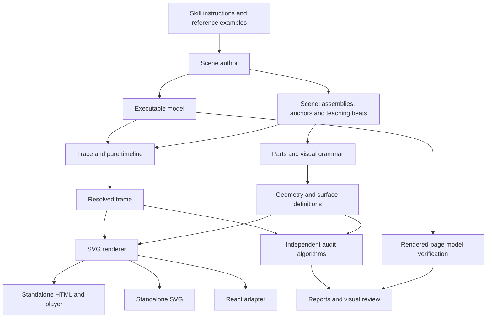

# Visualize: repeatable visual explanations

Architecture checkpoint after the first LRU redesign. This is the proposed next implementation, not a description of shipped capabilities.

## Product constraints

- Optimize composition for desktop first: review at 1440×900 and 1920×1080. Defer phone composition work; preserve existing accessibility and reduced-motion behavior.
- Fit the default desktop explanation into one viewport without page scrolling: title, diagram, current action, essential values and playback controls remain visible together. The information needed to understand the current step must be present; other steps are reached through time rather than a longer page.
- Open the transcript, provenance, assumptions and detailed metrics in an optional contained drawer or overlay. Opening details must not increase the main page height. Keep necessary labels readable; allow a scrolling fallback for high browser zoom or unusually short windows rather than clipping content or shrinking text below readable sizes.
- Motion and the figure carry the explanation. Keep visible words to short object labels, one current action, and essential values.
- No visible explanatory paragraphs in the default figure. Put the transcript, provenance, assumptions, extended explanation and detailed metrics in an optional details surface.
- One consistent visual language across scenes. Authors choose meaningful parts and behavior; the kit supplies their finish.
- Keep the executable model, seekable timeline, independent model checks and linked mathematics.

Proposed copy budgets for the next reference, subject to visual review: a title of at most eight words, one action of at most twelve words, labels of one to three words, and a prediction question of at most twelve words. These apply to explanation copy in the default view; equations, essential data, accessible names and the optional transcript need their own treatment. Do not truncate meaningful content automatically.

## Current foundation and gaps

| Boundary | Already implemented | Needed for repeatable craft |
|---|---|---|
| Model and time | Pure models, trace, keyed identity, frameAt(t), seek and rewind | Keep these contracts stable while evolving the representation |
| Geometry | Fixed isometric camera, boxes, rounded box plans, vertical cylinders, depth sort | Rounded extrusion profiles, real bevels, rings, rails, sockets, channels and routed connectors as examples require them |
| Presentation | SVG reconciliation, CSS tones, labels, HTML panels | Shared lighting/material rules, assemblies, semantic anchors, native part detail and a desktop figure shell |
| Teaching | Captions, chapters, prediction pause | Short actions, explicit per-step focus and staged reveal, with long explanations confined to optional details |
| Verification | Model agreement, depth sampling, replay, readability, layout, interaction; LRU composition, tone and pin checks | Actual-shape clearances and support, connector terminals, line ends, motion-time anchoring and clearance checks |
| Distribution | Standalone HTML, internal exported TypeScript functions | A tested public authoring API, standalone SVG export and React integration using the same geometry |
| Skill | Research and three model-driven examples | A small entrypoint, capability-specific references, approved examples and held-out generation evaluations |

The current composition check measures the width of the combined solids. It cannot distinguish an excellent composition from an oversized plate. The current pin check tests resting states; it does not establish anchoring throughout a move. Neither check is a visual quality score.

## Dependency structure



This is a single-package design initially. Module boundaries and separate entrypoints are useful now; separate published packages can wait until consumers require them. The pure core and geometry must not depend on browser APIs or React. The player, React adapter and skill workflow must not implement their own geometry or animation truth.

## 1. A geometry and parts kit

Keep three levels of authoring:

1. Geometry: rounded profiles, extrusions, bevels, cylinders and rings; add other forms when a real example needs them.
2. Parts: a tray with its recess, rim and anchor points; a rail with its guide and ticks; a token station; a terminal, server rack or ledger. Each part owns its detail and geometry record.
3. Assemblies: a cache rail, attention station or retry lane made from those parts. Assemblies expose entity ids, anchors, parameter limits and declared geometry.

Scene authors should not restyle a tray or hand-place its ticks every time. An assembly should support different capacities and contents without a custom CSS selector for each example. Detail belongs to a meaningful part; adding screws or grooves simply to increase path count is not a quality goal.

The representation must match the subject: a physical mechanism, the concept's own spatial structure, or native flat mathematics. A generic box diagram and a decorative mechanical metaphor are both poor defaults.

## 2. One visual grammar

Centralize camera angle, scale conventions, four restrained tone roles, edge treatment, bevel proportions, contact shadows, typography and spacing. Derive shading from surface orientation and a fixed light direction. Use one active accent at a time; retain explicit semantic colour only when distinguishing outcomes or values matters to the explanation.

The figure shell should be figure-dominant within a single desktop viewport, with a short title, one adjacent action and compact controls. Allocate a compact header and control strip around a flexible stage that uses the remaining height. Place detail drawers outside the primary visual hierarchy. Avoid a tall article header above the object and permanently visible dashboard panels below it. Verification must check horizontal and vertical page overflow at 1440×900 and 1920×1080 for every resting step, including prediction and feedback states; separately inspect intermediate motion for clipping.

Visual rules belong in the kit and shell, with documented exceptions, rather than in repeated scene-specific CSS.

## 3. Teaching beats and semantic anchors

Add explicit teaching intent to the existing trace:

- **Focus:** which entities matter in this beat; lower the visual emphasis of the rest while maintaining readable necessary labels.
- **Reveal:** which parts and representations become relevant now.
- **Action:** one short statement of the change.
- **Prediction:** a brief pause at a causal decision, with compact feedback.

Keep the model event separate from presentation intent. One domain event may need several teaching beats without inventing extra cache operations or payment events.

Name anchors on parts: entry.top, tray.front, server.input, ledger.output. Labels and connectors bind to anchors and resolve from the current frame. They follow a hopping, scaling or moving entity automatically; absolute coordinates should be an explicit escape hatch.

For LRU, the primary actions can be as short as "A moves to most recent", "Which entry leaves?", and "B leaves. D enters." The figure must make their reasons visible.

## 4. Audits with a geometry record

Parts register the shapes actually drawn, their supporting surfaces, connector terminals, routes and local transforms. Use independent algorithms to check these records and compare the rendered output where appropriate. Sharing a geometry declaration avoids a second hand-maintained description; independent checking algorithms prevent a renderer from serving as its own oracle.

Extend checks in this order:

1. Anchors remain on their declared surfaces throughout sampled motion.
2. Moving solids and connector routes maintain declared clearances.
3. Parts rest on declared supports; deliberate floating or exploded parts have explicit states.
4. Connector terminals meet their named mounts; decorative lines terminate at a real edge, seam or approved printed detail.
5. Foreground subject coverage, crop, label crowding, copy budget and effective contrast after de-emphasis.

Use actual rounded and routed shapes as they are introduced. Bounding boxes are useful for a broad phase, not sufficient proof of shape contact or clearance. Start with analytic checks for supported primitives and sampled transition checks; report that sampling cannot prove continuous collision freedom. Each check needs a planted fault and a clean example.

Mechanical checks reject identifiable defects. Visual review still chooses composition, representation and teaching quality.

## 5. Approved examples and held-out evaluations

Finish LRU to the target standard before declaring it the reference. Apply the shared kit to attention and retries to expose missing abstractions. Add further examples only when they demonstrate a capability the first three do not cover.

Each reference includes its model, scene, observations, accepted desktop images, transition captures and reasons for important representation choices. Golden images are evidence of approved appearance, not a substitute for model checks.

Then evaluate fresh generation on unseen prompts, such as a ring buffer, connection pool, token bucket and binary search. Change capacity, labels and sequences to test reuse rather than memorization. Record correctness, visual-rule adherence, manual repairs and generation effort. Compare with and without the skill under the same model, prompt and tool budget. Do not call the system general-purpose based solely on its hand-tuned examples.

## 6. A thin installable skill and shared exports

The eventual skill folder contains:

```text
visualize/
  SKILL.md              Representation choice, authoring workflow, review gates
  references/           Parts API, visual grammar, motion and verification
  examples/             Approved runnable reference explanations
  evals/                Held-out prompts and scoring criteria
  scripts/              Build, audit, capture and export commands
  kit/                  A pinned release of the shared runtime and parts
```

This is a packaging target, not a request to create empty folders now. Skill instructions should teach how to choose and compose the supported capabilities, then run the tools. Avoid duplicating geometry recipes in prose or implying that a prompt can supply a missing primitive.

Standalone HTML, a standalone SVG snapshot, and a React component should use the same geometry, materials and frame computation. The SVG snapshot must embed its styles and necessary metadata. Add React as an adapter after the renderer can run independently of the page player; avoid a parallel drawing implementation.

## Next review checkpoint

1. Establish the desktop composition and minimal-copy contract in the LRU reference.
2. Extract its rail, trays and entries into reusable parts with local anchors, using the existing geometry first.
3. Add focus and reveal as presentation behavior, and validate anchoring during movement.
4. Capture the revised LRU at 1440×900 and 1920×1080, inspect the object and motion, then stop for review.

Only after that visual bar is accepted should the library be extended across attention and retries and packaged as a skill. Keep current mobile safeguards; defer new phone-specific layouts and polish.

## Reference

The reusable-kit, constrained-style, audits, examples and export separation is informed by the [Anatomy repository](https://github.com/wheresryan22/anatomy), checked against the installed skill and the repository. The proposed design above is specific to Visualize and retains its model-verified, seekable explanations. No Anatomy implementation is copied by this architecture checkpoint.
