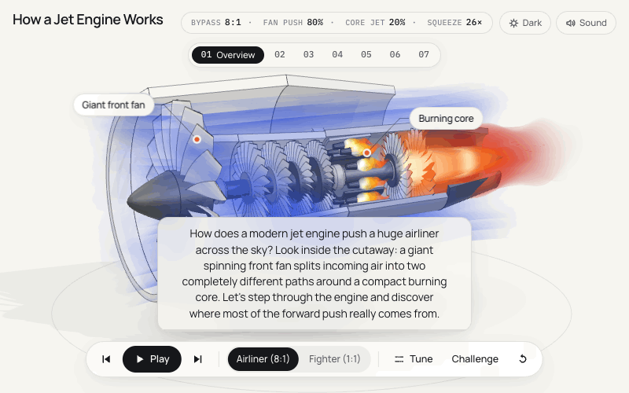
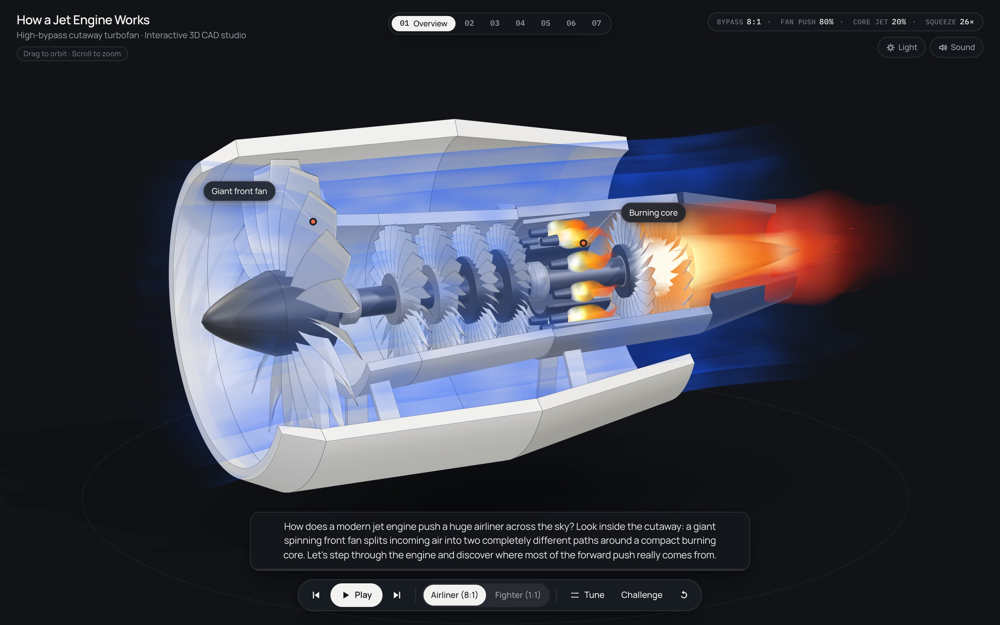
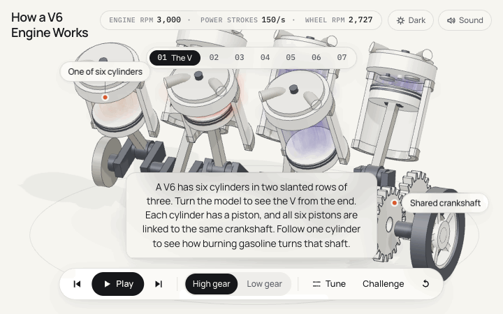
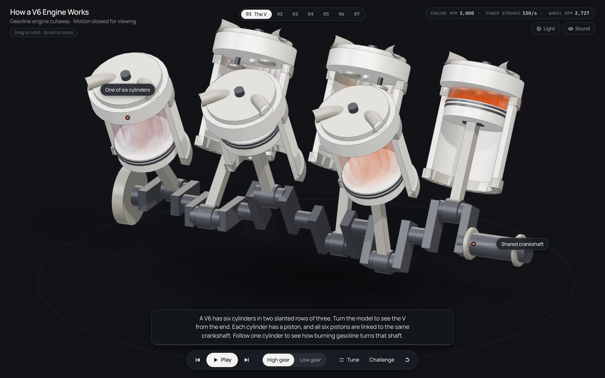
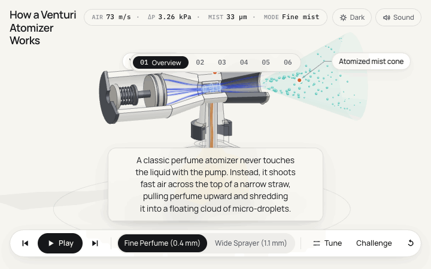
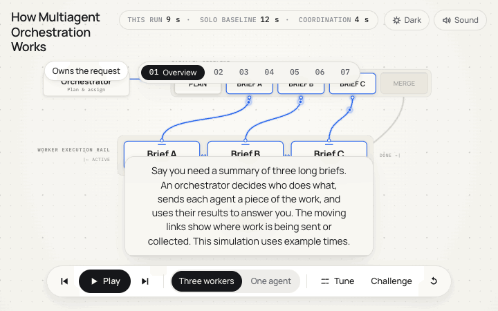

<h1 align="center">Visualize</h1>

<p align="center">
  <b>Turn a one-line prompt into an interactive, voice-guided 3D cutaway or tactile explainer you can actually trust.</b><br>
  Volumetric WebGL 3D CAD for physical machines &amp; devices · Braun/Rams tactile instruments for algorithms &amp; systems.<br>
  Driven by a tested simulation model, verified in headless Chrome, and signed off by two independent fresh-context reviewers.
</p>

<p align="center">
  <a href="#install"></a>
  <a href="#install"></a>
  <a href="#install"></a>
  <a href="https://agentskills.io"></a>
  <a href="#requirements"></a>
  <a href="SKILL.md"></a>
  <a href="LICENSE"></a>
  <a href="https://github.com/Aaryan1524/Visualize/actions/workflows/ci.yml"></a>
</p>

<p align="center">
  <a href="#30-second-quick-start">Quick start</a> ·
  <a href="#showcase">Showcase</a> ·
  <a href="#architecture">Architecture</a> ·
  <a href="#why-it-doesnt-hallucinate">Verification</a> ·
  <a href="#install">Install</a> ·
  <a href="#prompts-to-try">Prompts</a> ·
  <a href="#requirements">Requirements</a>
</p>

<p align="center">
  <a href="https://github.com/Aaryan1524/Visualize/releases/download/v3.1.0/turbofan-studio-demo.mp4"></a>
</p>

<p align="center"><sub><b>High-Bypass Turbofan Jet Engine — Complete End-to-End 7-Step Demo</b> — built from <code>/visualize explain how a jet engine works</code>.<br>Orthographic matte-clay 3D CAD, procedural GLSL volumetric airflow &amp; jet exhaust, Dim &amp; Illuminate camera tour, Airliner (8:1) ↔ Fighter (1:1) morph, and Light/Dark modes.<br><a href="https://github.com/Aaryan1524/Visualize/releases/download/v3.1.0/turbofan-studio-demo.mp4"><b>▶ Watch the complete end-to-end HD demo (MP4, 1280×800)</b></a> · <a href="https://github.com/Aaryan1524/Visualize/releases/download/v3.1.0/turbofan-studio-tour.mp4"><b>▶ Narrated voice tour (MP4, with sound)</b></a></sub></p>

---

## Showcase

Every animation and screenshot below is captured directly from a standalone, offline HTML page built with **Visualize Studio v3.1**.

<table>
  <tr>
    <td width="50%"></td>
    <td width="50%"></td>
  </tr>
  <tr>
    <td><sub><b>Turbofan Jet Engine — Live Light Studio (Engine A · 3D CAD + WebGL)</b><br><code>/visualize explain how a jet engine works</code><br>Diffused fBM <code>airVolume()</code> bypass mist, volumetric flickering <code>combustorRing()</code> flames, and supersonic <code>jetPlume()</code> exhaust.</sub></td>
    <td><sub><b>Turbofan Jet Engine — Dark Obsidian Studio</b><br>Every page ships with one-click <b>Dark</b> mode (<code>uDarkMode</code>-adaptive shaders) keeping matte-clay solids and volumetric forces razor-sharp in both themes.</sub></td>
  </tr>
  <tr>
    <td width="50%"></td>
    <td width="50%"></td>
  </tr>
  <tr>
    <td><sub><b>V6 Internal Combustion Engine — Live Light Studio (Engine A · 3D CAD)</b><br><code>/visualize explain how a V6 engine works</code><br>Six slanted cutaway cylinders in two V-banks linked to a shared crankshaft, live 4-stroke gas cycles, and High/Low gear variants.</sub></td>
    <td><sub><b>V6 Internal Combustion Engine — Dark Studio</b><br>Interactive orbit &amp; zoom, real RPM / power-strokes-per-second telemetry, and a live <b>Now You Try</b> challenge verified against the physics model.</sub></td>
  </tr>
  <tr>
    <td width="50%"></td>
    <td width="50%"></td>
  </tr>
  <tr>
    <td><sub><b>Venturi Perfume Atomizer — Live (Engine A · Fluid &amp; Glass 3D)</b><br><code>/visualize explain how a perfume atomizer works</code><br>Cutaway <code>glassVessel()</code>, Bernoulli pressure drop, feathered throat airflow, rising amber liquid, and an animated micro-droplet <code>mistCone()</code>.</sub></td>
    <td><sub><b>Multi-Agent Orchestration — Live (Engine C · Tactile Conceptual Studio)</b><br><code>/visualize explain how multi-agent orchestration works</code><br>Braun/Rams instrument on drafting paper: switchboard <code>strip</code> pipeline, milled <code>track</code> worker rail with spring lift-arc motion, and live <code>flowPipe</code> dispatch.</sub></td>
  </tr>
</table>

---

## 30-second quick start

Works out of the box in **Claude Code**, **Codex**, and **Antigravity** (and any [Agent Skills](https://agentskills.io)-compatible agent).

**1. Clone into your agent's skills folder & install once:**

```sh
# Claude Code
git clone https://github.com/Aaryan1524/Visualize.git ~/.claude/skills/visualize && cd ~/.claude/skills/visualize && npm install

# Codex
git clone https://github.com/Aaryan1524/Visualize.git ~/.agents/skills/visualize && cd ~/.agents/skills/visualize && npm install

# Antigravity (CLI)
git clone https://github.com/Aaryan1524/Visualize.git ~/.gemini/config/skills/visualize && cd ~/.gemini/config/skills/visualize && npm install
```

**2. Open a new session and ask for any machine, phenomenon, algorithm, or system:**

```text
/visualize explain how a V6 engine works
```

*(In Codex, type `$visualize ...`.)*

You get **one standalone offline HTML file** — interactive 3D orbit or tactile 2D instrument, light & dark themes, live monospace telemetry, offline Kokoro voiceover, What-If variants, Tune sliders, and a model-verified **Now You Try** challenge.

---

## Architecture

Visualize routes every prompt automatically (`src/studio/router.mjs`) to one of two deterministic, color-locked rendering engines wrapped in a single **Unified Frameless Director Shell** (`src/studio/director.mjs`):

| Engine | Visual Idiom | Used For | Key Primitives |
|---|---|---|---|
| **Engine A — 3D Physical CAD Studio** (`src/studio/engine-a.ts`) | Three.js Orthographic Matte-Clay + `EdgesGeometry` + `RoomEnvironment` + procedural GLSL volumetric shaders + damped `OrbitControls` | **Every physical object, machine, fluid/thermal/optical device, hardware, or organ** | `cutawayCylinder`, `bladeRing`, `combustorRing`, `shaft`, `pipe`, `spring`, `gear`, `glassVessel`, `liquidVolume`, `gasVolume`, `pistonPlunger`, `mistCone`, `airVolume`, `jetPlume`, `flowRibbon`, `boxPlate`, `baseMount` |
| **Engine C — 2D Tactile Conceptual Studio** (`src/studio/engine-c.ts`) | Braun/Rams tactile instruments on warm drafting paper (`#f6f5f0`) / obsidian dark (`#111317`) | **Algorithms, data structures, protocols, distributed systems, ML/transformers, math, finance, circuits** | `strip` (switchboard stages/keys), `track` (milled rail with lift-arc spring reorder & eviction), `flowPipe` (packet lanes), `arcLink` (single-active-thread Bézier), `stageNode` |

### Built-in Guardrails
- **Color Lock:** Structural hardware uses strictly 4 monochrome tokens (`clayLight`, `clayMid`, `clayDark`, `graphite`). Saturated accents (`orange`, `cobalt`, `ember`, `teal`, `gold`) are reserved for active `focus[]` highlights and invisible forces (airflow, flames, pressure, liquids, active packets).
- **Volumetric WebGL Over Rigid Tubes:** Invisible physical forces use real procedural GLSL shaders (`airVolume` fBM mist, `jetPlume` Mach-diamond exhaust, volumetric `combustorRing` flames) with automatic Light/Dark `uDarkMode` adaptation.
- **Single Source of Truth (`simModel`):** One pure function drives 3D/2D animation, quiet top-right telemetry, and live `Now You Try` challenge verification — zero arithmetic drift.
- **Cinema-Minimal Chrome:** ≥85% unobstructed canvas, Dim & Illuminate, Progressive Reveal, hard callout budget (≤2 per step, collision-resolved), floating subtitle bar, and compact bottom pill dock.

---

## Why it doesn't hallucinate

Visualize runs a strict **6-step studio pipeline** across **Claude Code, Codex, and Antigravity**:

```text
  Prompt ──▶ 1. ROUTE & SCAFFOLD  Auto-select Engine A (3D CAD) or Engine C (2D Tactile) via `new-studio.mjs`
         ──▶ 2. BUILD & TEST      Write tested `simModel()`, 60–140 line `scene.mjs`, and 5–7 step `build.mjs`
         ──▶ 3. CHROME GATE       `check-studio.mjs` verifies zero errors, valid telemetry, callouts, variants & themes
         ──▶ 4. DUAL VERIFIERS    2 parallel read-only fresh-context reviewers (Concept Auditor + Visual Director)
         ──▶ 5. REVIEW SEAL       `studio-review.mjs verify` enforces SHA-256 locks + passing Chrome stamp
         ──▶ 6. VOICE & SHIP      Offline Kokoro TTS narration (`studio-voice.mjs`) + final standalone HTML build
```

- **Zero self-grading:** `studio-review.mjs` generates two disjoint fresh-context verifier briefs (one audits `model.mjs` + config without screenshots; one audits **only** the 4 fresh PNGs without code) and seals them with SHA-256 hashes bound to the HTML and Chrome check stamp.
- **Zero swallowed runtime errors:** `check-studio.mjs` fails immediately on uncaught errors, unknown focus/camera targets, `NaN` or `?` telemetry, or colliding/clipped callouts.

---

## Install

Visualize follows the open [Agent Skills](https://agentskills.io) standard — this repository *is* the skill folder.

| Agent | Install command | Invoke with |
|---|---|---|
| **Claude Code** | `git clone https://github.com/Aaryan1524/Visualize.git ~/.claude/skills/visualize` | `/visualize …` |
| **Codex** | `git clone https://github.com/Aaryan1524/Visualize.git ~/.agents/skills/visualize` | `$visualize …` |
| **Antigravity (CLI)** | `git clone https://github.com/Aaryan1524/Visualize.git ~/.gemini/config/skills/visualize` | `/visualize …` |
| **Antigravity (App)** | `git clone https://github.com/Aaryan1524/Visualize.git ~/.gemini/antigravity/skills/visualize` | `/visualize …` |
| **Single project** | Clone into `.claude/skills/visualize` or `.agents/skills/visualize` inside your repo | as above |

Install dependencies once inside the cloned folder:

```sh
cd <your-visualize-folder> && npm install
```

Start a new agent session and you're ready. Update anytime with `git pull`.

<details>
<summary><b>Troubleshooting: Codex sandbox &amp; Antigravity headless permissions</b></summary>

<br>

- **Codex:** Headless Chrome checks (`check-studio.mjs`) may be blocked by Codex's sandbox — the HTML still builds cleanly. Approve running `check-studio.mjs` outside the sandbox when prompted, or run `node ~/.agents/skills/visualize/scripts/check-studio.mjs dist/<slug>.html --shots <dir>` in your terminal.
- **Antigravity (`agy -p`):** Add allow rules for `~/.gemini/config/skills/visualize` and `node ~/.gemini/config/skills/visualize/scripts/` under `permissions.allow` in `settings.json` to run unattended without prompts.

</details>

---

## Prompts to try

```text
# Engine A — 3D Physical CAD & Volumetric WebGL
/visualize explain how a jet engine works
/visualize explain how a V6 internal combustion engine works
/visualize explain how a perfume atomizer sprays mist
/visualize explain how a lithium-ion battery charges and discharges
/visualize explain how a mechanical watch escapement keeps time

# Engine C — 2D Tactile Conceptual Instruments
/visualize explain how multi-agent orchestration works
/visualize explain how an LRU cache achieves O(1) lookup and eviction
/visualize explain how a TCP 3-way handshake and fast retransmit work
/visualize explain how transformer self-attention routes context across tokens
```

---

## Repository layout

<details>
<summary><b>Project structure &amp; developer commands</b></summary>

<br>

```text
visualize/
├── SKILL.md                     Studio v3.1 pipeline, 2-Engine split & guardrails
├── src/studio/
│   ├── engine-a.ts              Engine A: Three.js Orthographic Matte-Clay 3D CAD + Volumetric WebGL shaders
│   ├── engine-c.ts              Engine C: 2D Tactile Conceptual Studio (strip, track, flowPipe, arcLink, stageNode)
│   ├── director.mjs             Unified Frameless Director Shell (telemetry, focus/reveal, callouts, challenges)
│   ├── studio-page.mjs          Standalone offline HTML bundler
│   └── router.mjs               Deterministic 2-Engine topic router
├── scripts/
│   ├── new-studio.mjs           Route & scaffold a new Engine A or Engine C studio project
│   ├── check-studio.mjs         Headless Chrome runtime, telemetry, callout & visual screenshot gate
│   ├── studio-review.mjs        Dual fresh-context verifier brief generator & SHA-256 verification gate
│   └── studio-voice.mjs         Offline Kokoro TTS narration with technical-token normalization
├── references/
│   ├── studio-engines.md        Type-exact Engine A (17 primitives) & Engine C (5 primitives) cheat-sheets
│   ├── studio-director.md       Storyboard schema, simModel contract, challenges & diagnostics
│   └── studio-qa.md             QA pipeline, verifier schema & recovery triage
└── examples/
    ├── turbofan-studio/         Flagship Engine A: High-bypass turbofan with airVolume + jetPlume
    ├── venturi-atomizer/        Flagship Engine A: Cutaway glass Bernoulli atomizer with mistCone
    └── lru-studio/              Flagship Engine C: Tactile O(1) LRU cache with lift-arc spring rail
```

```sh
npm test                                                  # Full unit & integration test suite (690+ tests)
npm run typecheck                                         # Strict TypeScript check
node examples/turbofan-studio/build.mjs                   # Build dist/turbofan-studio.html
node scripts/check-studio.mjs dist/turbofan-studio.html --shots /tmp/shots --fast
```

</details>

---

## Requirements

| Requirement | Needed for | Notes |
|---|---|---|
| **[Claude Code](https://code.claude.com/docs/en/overview)**, **[Codex](https://developers.openai.com/codex/skills)**, or **[Antigravity](https://antigravity.google)** | Running the skill | Follows the open Agent Skills format; tested across all three. |
| **Node.js 24+** | Builds & checks | Runs TypeScript directly via native type stripping. |
| **Chrome or Chromium** | Visual & runtime QA | Auto-detected on macOS, Linux, and Windows (`CHROME_PATH` override supported). |
| **~90 MB (once)** | Offline voiceover | Kokoro TTS downloads once on first narration run, then runs 100% offline. |

## Limits

- **Desktop first.** Standalone pages open on mobile, though the interactive 3D orbit + dock layout is tuned primarily for desktop viewports (`1280×800`+).
- **Thorough by design.** Building a verified simulation model, 3D CAD or tactile 2D scene, headless Chrome QA, dual fresh-context reviews, and offline voiceover takes a real multi-step run — not an instant one-shot SVG dump.

## Contributing

Contributions are welcome! Check the [open issues](https://github.com/Aaryan1524/Visualize/issues) for roadmap items (Engine A reciprocating primitives, Engine C lifelines/brackets, narration-vs-model numeric audit), or see [CONTRIBUTING.md](CONTRIBUTING.md), [CODE_OF_CONDUCT.md](CODE_OF_CONDUCT.md), and [SECURITY.md](SECURITY.md).

## License

[MIT](LICENSE) © 2026 Aaryan
