<h1 align="center">Visualize</h1>

<p align="center">
  <b>Turn a one-line prompt into a narrated, interactive 3D cutaway or explainer you can actually trust.</b><br>
  Recognizable 3D cutaways for everyday objects, to-scale assemblies for real machines, and matching 3D figures for algorithms and systems.<br>
  Every number is proved by a running model, checked in headless Chrome, and signed off by an independent reviewer.
</p>

<p align="center">
  <a href="#install"></a>
  <a href="#install"></a>
  <a href="#install"></a>
  <a href="https://agentskills.io"></a>
  <a href="#requirements"></a>
  <a href="CHANGELOG.md"></a>
  <a href="LICENSE"></a>
  <a href="https://github.com/Aaryan1524/Visualize/actions/workflows/ci.yml"></a>
</p>

<p align="center">
  <a href="#30-second-quick-start">Quick start</a> ·
  <a href="#built-from-a-one-line-prompt">Showcase</a> ·
  <a href="#why-it-doesnt-hallucinate">How it works</a> ·
  <a href="#what-the-reader-gets">Features</a> ·
  <a href="#install">Install</a> ·
  <a href="#prompts-to-try">Prompts</a> ·
  <a href="#requirements">Requirements</a>
</p>

<p align="center">
  <a href="https://github.com/Aaryan1524/Visualize/releases/download/v1.0.0/derailleur-tour.mp4">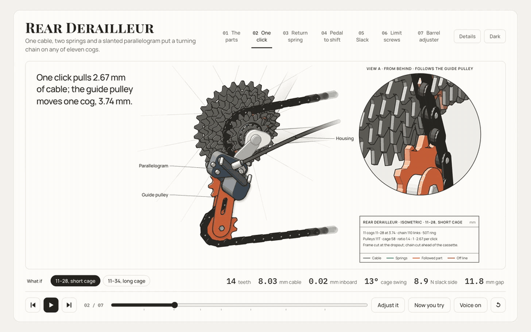</a>
</p>

<p align="center"><sub><b>Rear Derailleur</b> — generated from <code>/visualize explain how a bicycle rear derailleur works</code>.<br>A real spring-and-chain physics model drives the geometry; a local voice narrates each step; a lab lets you back out the limit screw.<br><a href="https://github.com/Aaryan1524/Visualize/releases/download/v1.0.0/derailleur-tour.mp4"><b>▶ Watch the full narrated tour (MP4, with sound)</b></a></sub></p>

---

## 30-second quick start

Works out of the box in **Claude Code**, **Codex**, and **Antigravity** (and any [Agent Skills](https://agentskills.io)-compatible agent).

**1. Clone into your agent's skills folder & install once:**

```sh
# Claude Code
git clone https://github.com/Aaryan1524/Visualize.git ~/.claude/skills/visualize && cd ~/.claude/skills/visualize && npm install

# Codex
git clone https://github.com/Aaryan1524/Visualize.git ~/.agents/skills/visualize && cd ~/.agents/skills/visualize && npm install

# Antigravity (CLI)
git clone https://github.com/Aaryan1524/Visualize.git ~/.gemini/config/skills/visualize && cd ~/.gemini/config/skills/visualize && npm install
```

*(Using the Antigravity desktop app or want a per-project install? See [Install](#install).)*

**2. Open a new session and ask for anything:**

```text
/visualize explain how a car's open differential works
```

*(In Codex, type `$visualize ...`. Want a multi-chapter deep dive? Add `--deep`.)*

You get **one standalone HTML file** — offline, light & dark themes, interactive 3D camera, voice narration, prediction checkpoints, and an interactive lab.

---

## Built from a one-line prompt

Every image below is an unedited screenshot of a standalone HTML page built from [`examples/`](examples), verified in headless Chrome, and rendered in the v2.0.0 Visual Design Engine.

<table>
  <tr>
    <td width="50%">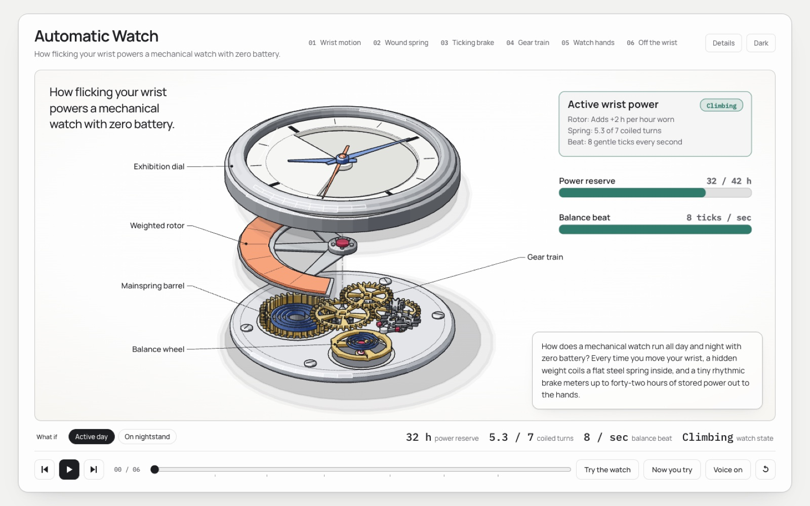</td>
    <td width="50%">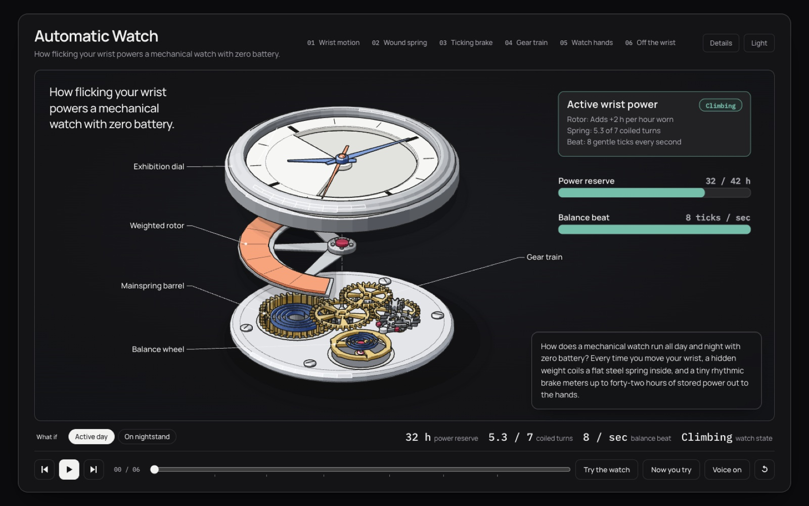</td>
  </tr>
  <tr>
    <td><sub><b>Automatic Watch — Everyday Mode (Light · Voice ON)</b><br><code>/visualize explain how an automatic watch works</code><br>3-layer exhibition cutaway solved by <code>solveGearTrain()</code> &amp; <code>composeExplodedLayers()</code> with 3-point studio lighting and plain college-level explanation.</sub></td>
    <td><sub><b>Automatic Watch — Everyday Mode (Dark Theme)</b><br>Every page ships with one-click <b>Dark</b> mode (or <code>#theme=dark</code>) on a studio watchmaker's mat with light-faithful 3D solids and 0% leader crossings.</sub></td>
  </tr>
  <tr>
    <td width="50%">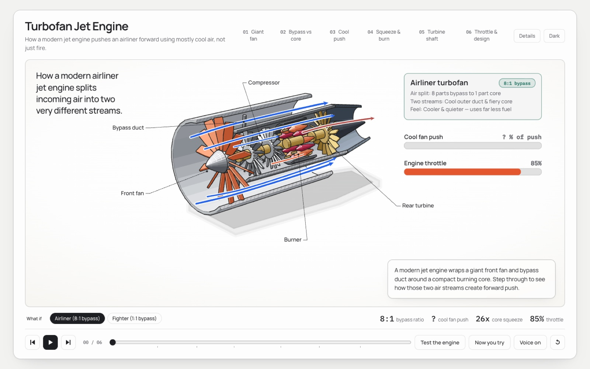</td>
    <td width="50%">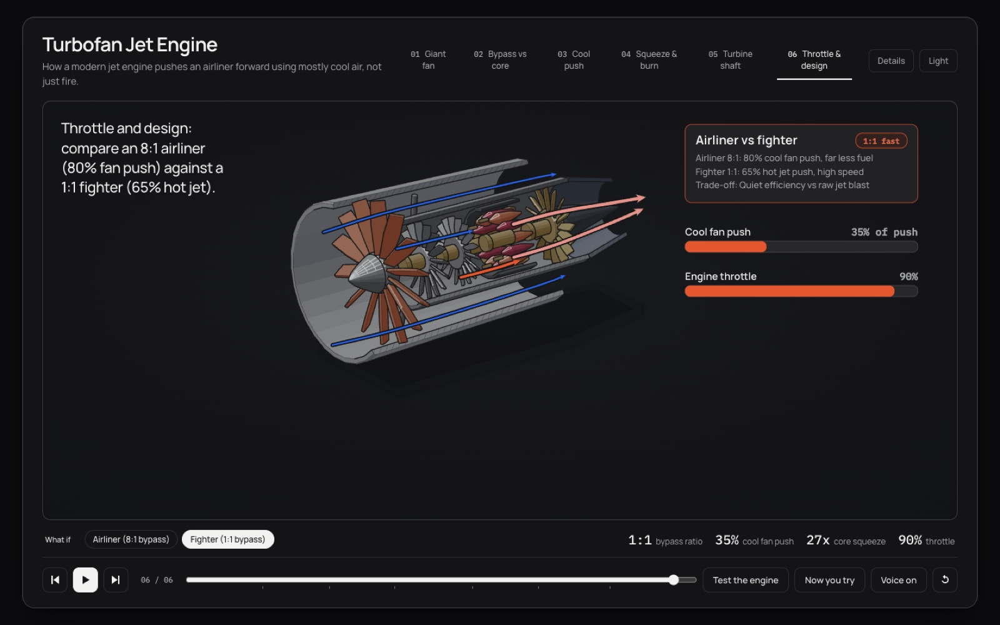</td>
  </tr>
  <tr>
    <td><sub><b>Turbofan Jet Engine — Airliner 8:1 Bypass (Light · Voice ON)</b><br><code>/visualize explain how a jet engine works</code><br>Built on <code>spread("axial-cutaway")</code> + <code>axialHousing</code> + <code>turbineRotor</code> + <code>flowArrow3D</code> showing why 80% of airliner push comes from cool bypass air.</sub></td>
    <td><sub><b>Turbofan Jet Engine — Fighter 1:1 Variant (Dark Theme)</b><br>One-click <b>What if</b> switches between an <code>8:1</code> airliner and a <code>1:1</code> fighter core (65% hot jet push) with live throttle &amp; bypass sliders.</sub></td>
  </tr>
  <tr>
    <td width="50%">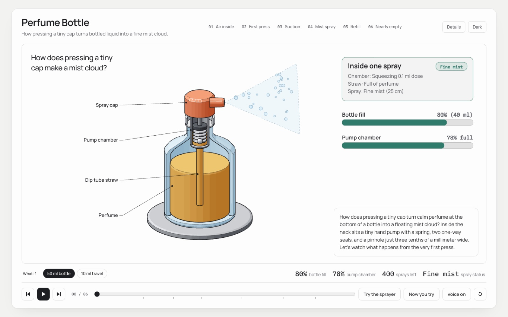</td>
    <td width="50%">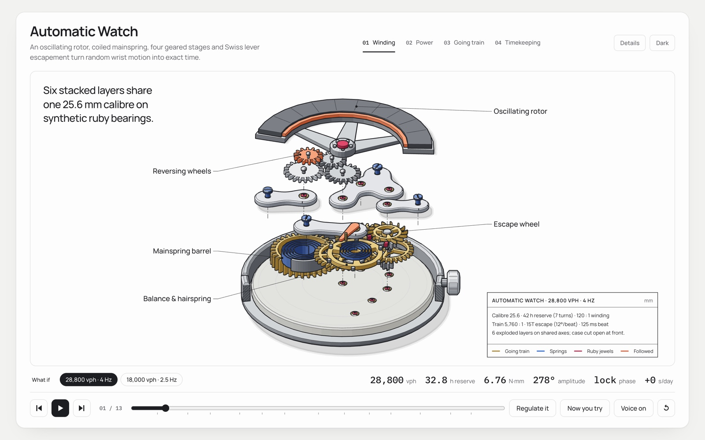</td>
  </tr>
  <tr>
    <td><sub><b>Perfume Bottle (Default Everyday Mode · Voice ON)</b><br><code>/visualize explain how a perfume bottle sprays</code><br>Real 3D cutaway glass bottle, pressable spray cap, animated mist cone, and plain college-level side explainer with live fill meters.</sub></td>
    <td><sub><b>Automatic Mechanical Watch (<code>--deep --technical</code>, 14 steps · 4 chapters)</b><br><code>/visualize --deep --technical explain how an automatic watch keeps time</code><br>6-layer exploded calibre on dashed centre lines, live balance-wheel beat, Swiss lever escapement, and mainspring torque curve.</sub></td>
  </tr>
  <tr>
    <td width="50%">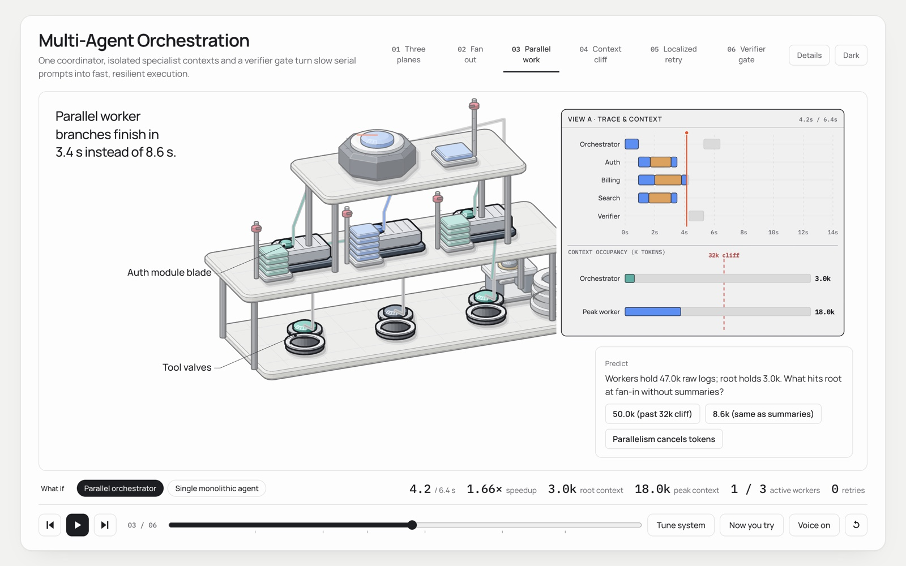</td>
    <td width="50%">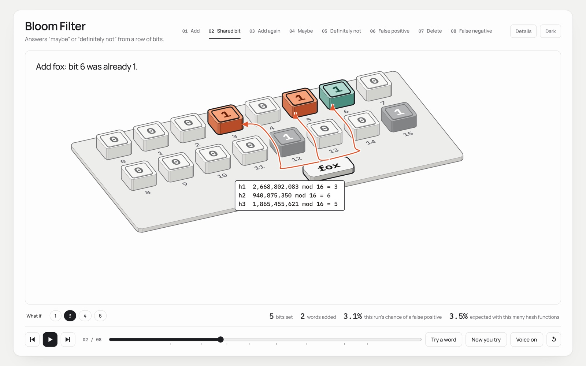</td>
  </tr>
  <tr>
    <td><sub><b>Multi-Agent Orchestration (<code>--deep</code>, 14 steps · 4 chapters)</b><br><code>/visualize --deep explain multi-agent orchestration</code><br>3-tier Concept Plate with per-step camera moves, live Gantt Trace + Context Occupancy lens, and interactive Predict checkpoints.</sub></td>
    <td><sub><b>Bloom Filter</b><br><code>/visualize explain how a Bloom filter works</code><br>16-bit array on the Concept Plate rig, routed hash arrows, live <code>h₁/h₂/h₃ mod 16</code> working strip, and false-positive proof.</sub></td>
  </tr>
  <tr>
    <td width="50%">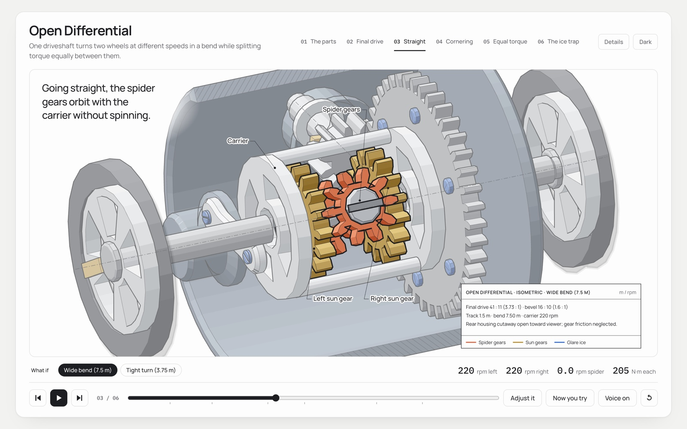</td>
    <td width="50%">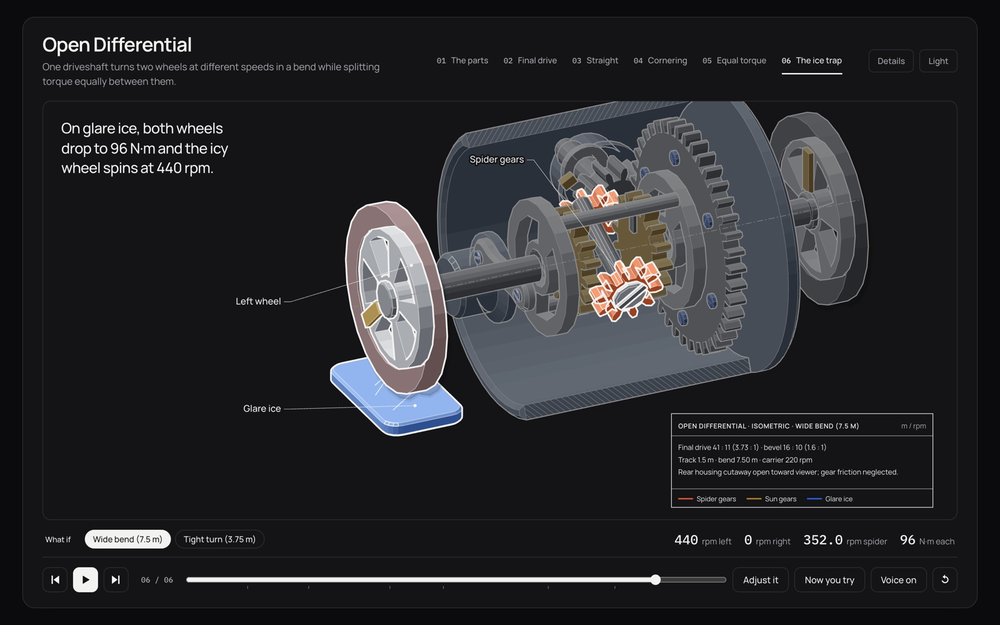</td>
  </tr>
  <tr>
    <td><sub><b>Open Differential — Light Theme</b><br><code>/visualize --technical explain how an open differential works</code><br>Cutaway steel carrier, orbiting bevel spiders, brass sun gears, and <code>ω_L + ω_R = 2·ω_ring</code> enforced by the physics model.</sub></td>
    <td><sub><b>Open Differential — Dark Theme (Glare-Ice Trap)</b><br>Every page ships with a one-click <b>Dark</b> toggle (or <code>#theme=dark</code>). Here, low traction on the left wheel stalls the right wheel at 0 rpm.</sub></td>
  </tr>
</table>

<details>
<summary><b>More examples</b> — Pin Tumbler Lock, LRU Cache (Drawing &amp; Clay), Attention, Idempotent Retries</summary>

<br>

<table>
  <tr>
    <td width="50%">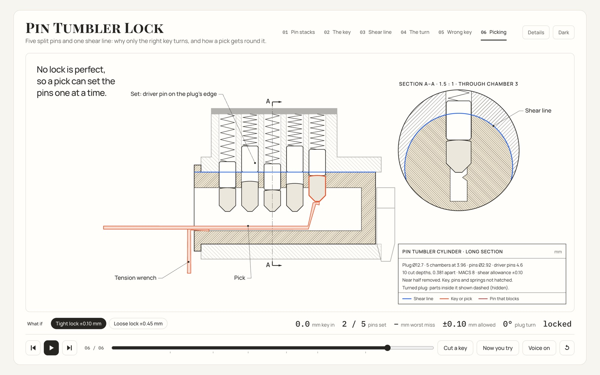</td>
    <td width="50%">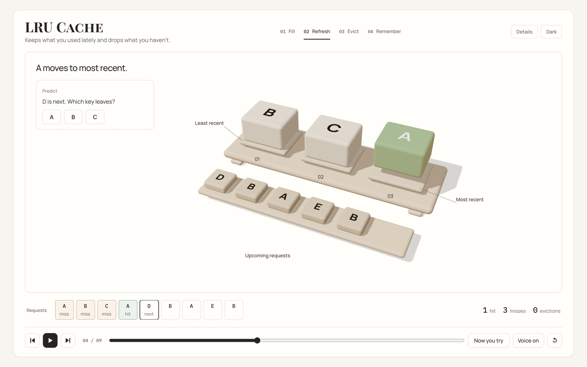</td>
  </tr>
  <tr>
    <td><sub><b>Pin Tumbler Lock</b> — why only 1 of ~92,000 keys turns, how picking exploits binding order, and a key-cutting lab.</sub></td>
    <td><sub><b>LRU Cache</b> — paused on a prediction before the first eviction; hit/miss strip driven directly by the model.</sub></td>
  </tr>
  <tr>
    <td width="50%">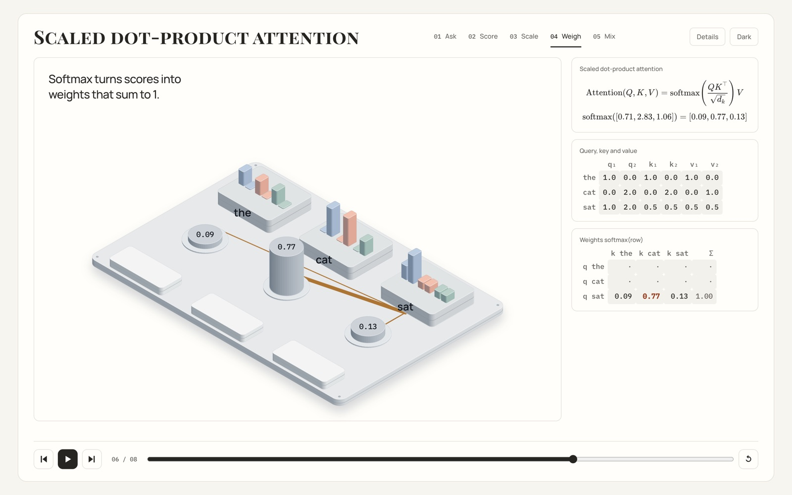</td>
    <td width="50%"></td>
  </tr>
  <tr>
    <td><sub><b>Scaled Dot-Product Attention</b> — hovering a softmax weight lights the query and key vectors that produced it.</sub></td>
    <td><sub><b>Idempotent Retries</b> — two synced worlds side by side showing why a lost reply double-charges without a key.</sub></td>
  </tr>
</table>

</details>

---

## Why it doesn't hallucinate

Most AI-generated diagrams look pretty for two seconds and break the moment you read the numbers — mismatched gear ratios, floating labels, impossible physics, or prose that contradicts the drawing.

Visualize runs a strict **7-stage engineering pipeline** designed to deliver the same studio-grade result across **Claude, Codex, and Gemini**:

```text
  Prompt ──▶ 1. PLAN      Pick Object / Machine / Concept lane, mode (`everyday`, `--fast`, `--technical`, `--deep`), and story arc
         ──▶ 2. SCAFFOLD  `new-figure.mjs` stamps out the studio shell (rig, palette, dark mode, tests)
         ──▶ 3. MODEL     Write a real executable model + independent reference test (physics or state trace)
         ──▶ 4. RIG       Draw every frame from model outputs using `objects.ts` / `mech.ts` / `concept.ts` 3D primitives
         ──▶ 5. VOICE     Record offline narration that lights up each part in sync as it names it (skipped in `--fast`)
         ──▶ 6. CHECKS    Headless Chrome audits: layout, label overlap, contrast, FPS, arithmetic claims
         ──▶ 7. REVIEW    Mandatory fresh-context reviewer inspects every step PNG, concept truth, and math
```

- **Zero hand-waved math.** [`check-arithmetic.mjs`](scripts/check-arithmetic.mjs) parses equations and readouts in the built HTML and flags any mismatch against the model.
- **Zero visual regressions.** [`check-drawing.mjs`](scripts/check-drawing.mjs) opens the page in headless Chrome across light & dark themes, checks label collisions, bounding-box clipping, contrast, and frame pacing.
- **Zero self-grading.** Before any visualization is marked done, [`review-brief.mjs`](scripts/review-brief.mjs) packages the rendered step screenshots and audit output for a **fresh-context reviewer** (independent subagent or dedicated pass) that can only pass when both the studio craft *and* the underlying domain truth hold up.

---

## What the reader gets

| Capability | What it actually does |
|---|---|
| **Model-verified visuals** | Every position, angle, count, highlight, and caption is computed by a tested model and verified against the live DOM in headless Chrome. |
| **6 Figma-style Spread Presets** | `src/rig/spreads.ts` locks in 6 proven stage layouts (`cutaway-vessel`, `exploded-stack`, `axial-cutaway`, `linked-train`, `concept-plate`, `system-tiers`) with mathematically guaranteed zero-overlap zones, auto-spaced callout rails (`distributeCallouts`), and upper-right HUD stacks (`renderHudStack`). |
| **Universal 3D engineering blocks** | Everyday objects (`vesselShell`, open-heart `watchCaseDial`, `calibrePlate`), universal engineering solids (`axialHousing`, `turbineRotor`, `pistonAssembly`, `helicalCoil`, `electrodeStack`, `flowArrow3D`), precision gear trains (`src/rig/mech.ts`), and 3D Concept Plates (`src/rig/parts.ts`, `concept.ts`) all share one 3-point studio rig. |
| **Light-faithful dark mode** | One-click **Dark** mode (or `#theme=dark`) keeps crisp dark-ink 3D solids and studio materials intact on a dark watchmaker's mat, so gear teeth, bevels, dials, and cutaways stay razor-sharp in both themes. |
| **Synced voice narration** | Recorded locally via an open-source TTS model (offline after one ~90 MB download). Explains the big idea first, then walks step-by-step and highlights each part the moment it's spoken. |
| **Active learning built in** | **Predict** cards pause before the twist; **Labs / What if** let the reader change real parameters (cut a key, drop traction to ice, flood a queue); **Now you try** quizzes are generated and graded by the model. |
| **Standalone HTML + 1-command Figma-ready SVG** | Zero external runtime dependencies — share via Slack, embed in docs, or open offline with keyboard navigation (`←` `→` `Space`), `#step=` deep links, reduced motion, and transcripts. Export any step as a clean, layered, editable **Figma-ready `.svg`** with `npm run export:drawing-svg` (expands `<use>`, bakes `color-mix()` to static hex, and names every `<g id="part-...">` layer). |

---

## Install

Visualize follows the open [Agent Skills](https://agentskills.io) standard — this repository *is* the skill folder. Clone it into your agent's skills directory under the name `visualize`, then run `npm install` once.

| Agent | Install command | Invoke with |
|---|---|---|
| **Claude Code** | `git clone https://github.com/Aaryan1524/Visualize.git ~/.claude/skills/visualize` | `/visualize …` |
| **Codex** | `git clone https://github.com/Aaryan1524/Visualize.git ~/.agents/skills/visualize` | `$visualize …` |
| **Antigravity (CLI)** | `git clone https://github.com/Aaryan1524/Visualize.git ~/.gemini/config/skills/visualize` | `/visualize …` |
| **Antigravity (App)** | `git clone https://github.com/Aaryan1524/Visualize.git ~/.gemini/antigravity/skills/visualize` | `/visualize …` |
| **Single project** | Clone into `.claude/skills/visualize` or `.agents/skills/visualize` inside your repo | as above |

Then install dependencies once inside that folder:

```sh
cd <your-visualize-folder> && npm install
```

Start a new agent session and you're ready. Update anytime with `git pull`.

<details>
<summary><b>Codex: if headless Chrome checks are blocked by the sandbox</b></summary>

<br>

Visualize checks every built page in headless Chrome. Codex's sandbox can prevent Chrome from launching — the HTML page still builds cleanly, and only the browser check fails with a clear message. Approve running the check command outside the sandbox when prompted (requires default `approval_policy = "on-request"`), or run it directly in your terminal:

```sh
node ~/.agents/skills/visualize/scripts/verify.mjs <scene-folder>
```

</details>

<details>
<summary><b>Antigravity: running headless (<code>agy -p</code>) without prompts</b></summary>

<br>

Add allow rules for the skill folder and `node` under `permissions.allow` in `settings.json` (or pass via `--settings`):

```json
{
  "permissions": {
    "allow": [
      "read_file(~/.gemini/config/skills/visualize)",
      "command(node ~/.gemini/config/skills/visualize/scripts/)"
    ]
  }
}
```

Add `read_file` / `write_file` rules for your project directory as well. In the interactive app, simply approve commands when prompted.

</details>

---

## Prompts to try

You don't even have to type `/visualize` — the skill also triggers automatically when you ask for an everyday object, machine, algorithm, protocol, or system to be explained visually or step by step.

### 4 composable modes

Pick the depth and tone that fits your question — by flag or plain English. Flags compose (e.g. `--deep --technical` for a multi-chapter engineering masterclass).

| Mode | Trigger flags / words | Best for | What you get |
|---|---|---|---|
| **Default (`everyday`)** | *(no flag)* | Curious learners & students | Best recognizable 3D real-object visual + plain-English side explainer, **voice ON**, 5–7 steps, Predict + Lab, real tested model underneath (no unrequested jargon). |
| **`--fast`** | `--fast`, *"quick"*, *"fast"*, *"brief"* | Fast intuition (~3–4 min) | Concise 4–5 step visual diagram, **no voice**, no What-if variants, streamlined Chrome checks & light/dark sanity shots. |
| **`--technical`** | `--technical`, *"engineering"*, *"exact math"*, *"with equations"* | Engineers & coursework | Exact SI units, live equations/working strips on stage, multi-variant What-if comparisons, strict domain & unit audit. |
| **`--deep`** | `--deep`, *"in depth"*, *"deep dive"*, *"thoroughly"* | Full mastery (10–15 min) | 4–6 chapters, 14–20 steps, highest visual detail, full voice, per-chapter Predict checkpoints, saved reading progress. |

```text
# Everyday physical objects (default everyday mode — real 3D cutaway + plain-English explainer)
/visualize explain how a perfume bottle sprays mist
/visualize explain how a wristwatch keeps time
/visualize --fast explain how a bicycle tire pump works

# Real machines (to-scale 3D cutaways & precision assemblies)
/visualize --technical explain how a car's open differential works
/visualize explain how a four-stroke internal combustion engine works
/visualize --deep --technical explain how an automatic mechanical watch keeps time

# Systems, protocols & ML (3D Concept Plates + live lenses)
/visualize --deep explain multi-agent orchestration
/visualize explain how a Bloom filter works with 16 bits and 3 hash functions
/visualize explain a token-bucket rate limiter: capacity 10, refill 2/s, show a burst draining it and recovery
/visualize explain TCP fast retransmit: lose a segment, show 3 duplicate ACKs, and export an SVG of the key step
/visualize explain database connection pooling (pool of 4) and give me a React component for our Next.js docs
```

**Three tips for the best output:**
1. **Include real numbers** (capacities, gear teeth, rates, bit counts) — the model runs directly on them.
2. **Name the dramatic moment** (*"glare ice stalls one wheel"*, *"a burst drains the bucket"*) — it becomes the Predict checkpoint.
3. **Add a mode flag if you want one** (`--fast`, `--technical`, `--deep`, or combine `--deep --technical`); otherwise default `everyday` gives you the best real-object visual with voice narration and plain English.

---

## How it works

<details>
<summary><b>Repository layout</b></summary>

<br>

```text
visualize/
├── SKILL.md                 Governing workflow, 3 visual lanes, 4 modes, and mandatory review gates
├── src/
│   ├── rig/                 3D studio rig, 6 Spread Presets (`spreads.ts`), spatial solvers (`layout.ts`),
│   │                        universal objects & machines (`objects.ts`, `mech.ts`, `parts.ts`, `concept.ts`)
│   ├── drawing/             Shared interactive Drawing page, camera easing, player, tabs, dark mode, lab
│   ├── claims/              Model-vs-prose arithmetic audit (`audit.mjs`, `arithmetic.mjs`)
│   ├── core/                Trace, steps, timeline, keyed interpolation, scene types
│   ├── unfold/              Directed 3D stage and looks (Drawing, Clay, Paper)
│   ├── iso/                 Isometric projection and depth sorting
│   ├── parts/               Reusable concept parts (rail, ring, tree, network, flow)
│   ├── render/              SVG stage, panels, player controls, styles
│   └── react/               React component adapter
├── references/              Detailed guides (`spreads.md`, `layout.md`, `objects.md`, `look.md`, `figures.md`, `concept-rig.md`, `drawing.md`, `craft.md`)
├── scripts/
│   ├── new-figure.mjs       Scaffolds a studio-grade Object, Machine, or Concept figure from templates
│   ├── templates/           Hardened starter templates (`object/`, `machine/`, `concept/`)
│   ├── check-drawing.mjs    Headless Chrome layout, contrast, callout, and FPS checks (`--fast` supported)
│   ├── check-arithmetic.mjs Verifies every equation and readout against the model
│   ├── shoot-steps.mjs      Captures light & dark contact sheets of every step (`--fast` supported)
│   ├── export-drawing-svg.mjs Exports any Drawing step as a layered, Figma-ready editable SVG
│   ├── review-brief.mjs     Builds the mandatory fresh-context reviewer brief (`--mode everyday|fast|technical|deep`)
│   ├── voice.mjs            Local offline TTS narration + word-level sync
│   └── build.mjs / verify.mjs / export-svg.mjs / plant-look.mjs
├── examples/                watch-everyday, perfume-atomizer, automatic-watch, differential, derailleur,
│                            escalator, lock, multi-agent, bloom, lru-3d, lru, attention, retries
├── test/fixtures/           Gallery scenes and planted-fault controls
└── evals/evals.json         Prompt benchmarks and acceptance criteria
```

</details>

<details>
<summary><b>Developer &amp; kit commands</b></summary>

<br>

```sh
npm install
npm test                                    # Model tests, engine tests, arithmetic & scaffold tests
npm run typecheck                           # TypeScript verification
npm run build                               # Build standalone dist/<scene>.html pages
npm run verify                              # Verify concept scenes in headless Chrome
npm run verify:controls                     # Planted faults: proves checks actually catch bugs
node scripts/new-figure.mjs <name> --kind=object|machine|concept --mode=everyday|fast|technical|deep
node scripts/check-drawing.mjs dist/<name>.html [--fast]    # Chrome layout/FPS/contrast audit
node scripts/check-arithmetic.mjs dist/<name>.html          # Prose-vs-model arithmetic audit
node scripts/shoot-steps.mjs dist/<name>.html [--fast]      # Step screenshots for review
npm run export:drawing-svg -- dist/<name>.html --out <file.svg> [--step k] [--theme light|dark]
node scripts/review-brief.mjs <audit> <review> <page> --mode=everyday|fast|technical|deep
node scripts/voice.mjs <scene-dir>                          # Record synced offline narration
```

</details>

---

## Requirements

| Requirement | Needed for | Notes |
|---|---|---|
| **[Claude Code](https://code.claude.com/docs/en/overview)**, **[Codex](https://developers.openai.com/codex/skills)**, or **[Antigravity](https://antigravity.google)** | Everything | Follows the open Agent Skills format; tested end-to-end across all three. |
| **Node.js 24+** | Builds & checks | Runs TypeScript directly via native type stripping. Run `npm install` once in the skill folder. |
| **Chrome or Chromium** | Verification | Auto-detected on macOS, Linux, and Windows. Set `CHROME_PATH` for a custom binary. |
| **~90 MB (once)** | Voice narration | Open-source TTS model downloads on first use, then runs 100% offline. |

## Limits

- **Desktop first.** Pages open on phones, though the mobile layout is not yet as polished as desktop.
- **Voice is an explicit build step.** Run `node scripts/voice.mjs <scene>` after finalizing the script. Audio compresses to AAC on macOS; elsewhere it stays WAV. Prepared *What if* branches are not yet voiced.
- **Unfold 3D stage checks vs. Drawing checks.** All new studio figures (both Machines and Concepts) use the Drawing page + `rig/` pipeline and are checked by `check-drawing`, `check-arithmetic`, `shoot-steps`, and the independent reviewer. Legacy `unfold/` 3D scenes still have partial check coverage compared to the isometric stage.
- **Thorough by design.** Building a verified model, 3D rig, voice track, Chrome checks, and independent review takes a real session — not a 3-second SVG dump. That's why the numbers hold up.

## Contributing

Contributions are welcome! The single most valuable contribution is a [report of a figure that looks wrong or teaches badly](https://github.com/Aaryan1524/Visualize/issues/new?template=figure-problem.yml) — nearly every rule in `SKILL.md` started as one. See [CONTRIBUTING.md](CONTRIBUTING.md) for setup and PR gates, [Discussions](https://github.com/Aaryan1524/Visualize/discussions) for sharing pages you built, [CODE_OF_CONDUCT.md](CODE_OF_CONDUCT.md), and [SECURITY.md](SECURITY.md).

## License

[MIT](LICENSE) © 2026 Aaryan
