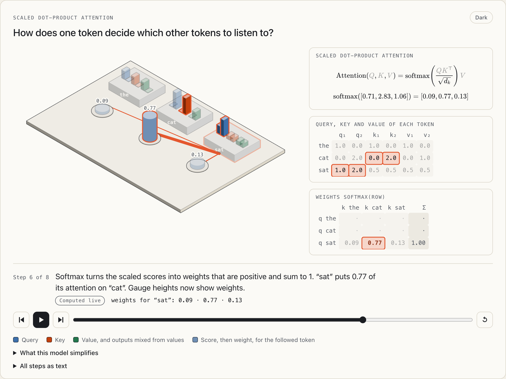

# Visualize

An engine for model-driven visual explanations. You write two small things:

- an executable **model** of the idea, which returns a trace of steps;
- a **view**, which maps each state to keyed marks.

The engine handles the rest:

- an isometric SVG stage, with flat panels for equations and number grids;
- motion between steps, with step, play, scrub, rewind and `#step=` links;
- linked highlighting across the stage and panels;
- light and dark themes, reduced motion, and a text version of every step;
- a single standalone HTML file per scene;
- **checks that the rendered page shows what the model computed**, at every step.

Status: a working prototype with three example scenes.


 See [Plan.md](Plan.md) for the plan and [research/PROTOTYPE_FINDINGS.md](research/PROTOTYPE_FINDINGS.md) for what the prototypes showed, including what doesn't work yet.

## Examples

| Scene | What it shows |
|---|---|
| `examples/lru` | LRU cache eviction on a recency rail; also built flat for comparison |
| `examples/attention` | Scaled dot-product attention (Vaswani et al. 2017, Eq. 1): scores, scaling and softmax as gauges that morph, linked to the equation and grids |
| `examples/retries` | A payment retried after a lost response, run in two synced worlds, without and with an idempotency key |

## Requirements

- Node.js 24 or newer (TypeScript runs through type stripping)
- pnpm
- Google Chrome or Chromium for `verify` and `shoot` (set `CHROME_PATH` if it isn't found)

## Commands

```sh
pnpm install
pnpm test              # models against reference implementations, engine unit tests
pnpm typecheck
pnpm build             # dist/<scene>.html, one standalone file each, plus dist/index.html
pnpm verify            # headless-browser checks of every scene against its model
pnpm verify:controls   # 21 planted faults: proves the checks can fail
node scripts/shoot.mjs dist/lru.html --out shot.png --step 4 [--width 390] [--theme dark] [--hover <selector>]
```

## Writing a scene

```ts
import { defineScene } from "../../src/core/scene.ts";

export default defineScene<State, Event>({
  id: "my-scene",
  title: "…",
  question: "The question the figure answers",
  trust: "computed", // sourced | computed | model | analogy | unverified
  trace: () => ({ initial, intro: "…", steps: [{ event, state, caption: "…" }] }),
  view: (state, event) => [{ kind: "box", key: "entity-1", at: [0, 0, 0], size: [24, 24, 18], tone: "subject", label: "A" }],
  panels: (state) => [{ key: "rule", title: "The rule", html: "…" }],
  observe: (state) => [{ type: "text", key: "entity-1", equals: "A" }],
});
```

Keys are model entity ids, and they are how motion, linking and checks find things. The three examples are the reference.

## What `verify` checks

The model runs in Node, separately from the page. Its observations, captions and readouts are compared with what Chrome actually draws:

| Check | How |
|---|---|
| Observations | Each step declares what the reader should see: a value, an order, a drawn size, what is visible, what is lit. Each one is read from the rendered page. "Visible" means unobstructed at a real share of the mark, not merely present |
| Captions | Caption, readout and trust label match the model at every step |
| Depth order | Wherever solids overlap on screen, the line of sight is ray-cast against the true geometry and compared with the element the browser paints on top, at rest and inside every transition |
| Determinism | A time shows the same page whatever was seen before it |
| Text | 11 px minimum, and WCAG contrast against the face or card behind it, in both themes |
| Labels | No overlaps, nothing wider than its face, nothing covered, nothing outside the card |
| Layout | No sideways scroll at 1280 and 390 px |
| Interaction | Arrow keys, Home, End and Space; reduced motion shows no in-between frames; `#step=` links |
| Linking | Pointing at a linked element, in the stage or a panel, lights exactly the related elements |
| Console | No errors or uncaught exceptions |

It also writes screenshots and two contact sheets per scene to `shots/`: every step at rest, and every transition at five instants. Passing checks do not prove the result explains well or looks good, so read the sheets. [PROTOTYPE_FINDINGS.md](research/PROTOTYPE_FINDINGS.md) lists what the checks cannot see.

## Layout

```
src/core     trace, steps, timeline, keyed interpolation, motion vocabulary, trust levels
src/iso      projection, solids, depth sort
src/render   SVG stage, player, panels, KaTeX helpers, styles
scripts      build, verify, in-page checks, screenshots
examples     the three scenes, each a model, its tests and a scene
test         fixtures for the planted-fault controls
research     landscape, Anatomy analysis, engine concepts, visual grammar, prototype findings
```

## Known gaps

- Detail is sparse: plain boxes and cylinders with three shades.
- Wide scenes shrink on phones instead of re-arranging.
- The camera is fixed per scene.
- KaTeX pages are about 690 KB because every font is inlined.
- No paper adapter and no Agent Skill package yet.

## Licence

MIT
