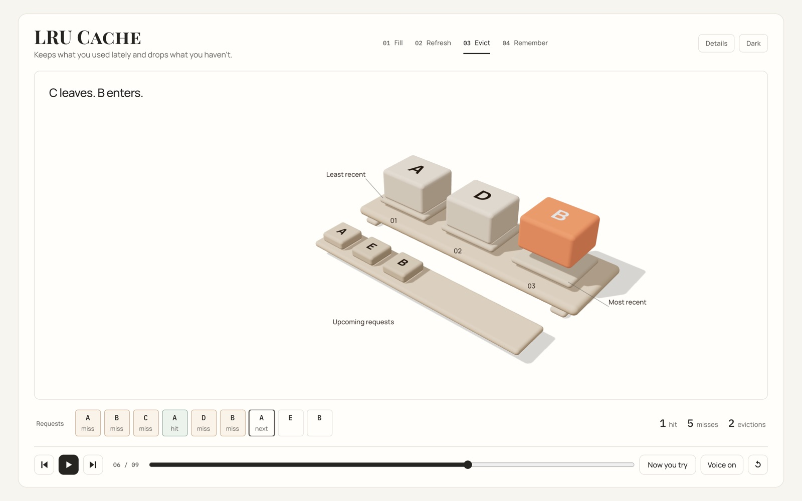
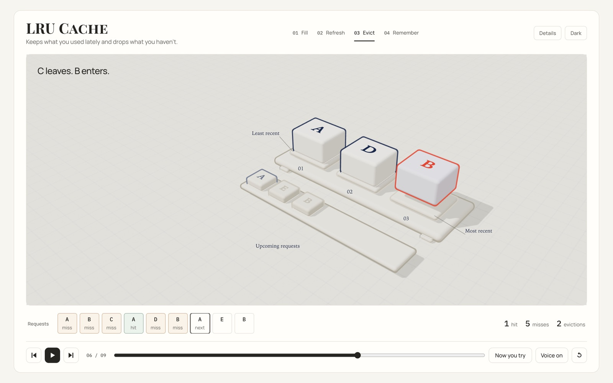
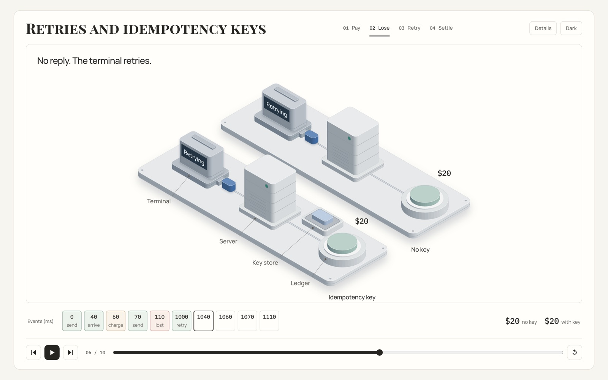

<h1 align="center">Visualize</h1>

<p align="center"><b>An Agent Skill that turns a one-line request into a step-through explanation you can trust.</b><br>A 3D figure that moves one step at a time, a voice that explains it, and a reader who predicts and practises.<br>Every number on the page is checked against a running model of the idea.</p>

<p align="center">
  <a href="https://code.claude.com/docs/en/skills"></a>
  <a href="https://agentskills.io"></a>
  <a href="LICENSE"></a>
  <a href="#requirements"></a>
  <a href="CHANGELOG.md"></a>
  <a href="https://github.com/Aaryan1524/Visualize/actions/workflows/ci.yml"></a>
</p>

<p align="center">
  <a href="#quick-start">Quick start</a> ·
  <a href="#gallery">Gallery</a> ·
  <a href="#what-the-reader-gets">What the reader gets</a> ·
  <a href="#install">Install</a> ·
  <a href="#usage">Usage</a> ·
  <a href="#how-it-works">How it works</a> ·
  <a href="#requirements">Requirements</a> ·
  <a href="#limits">Limits</a>
</p>

<p align="center">
  
</p>

<p align="center"><sub><code>examples/lru-3d</code>, the flagship: an LRU cache in the Clay look, paused on a prediction before the first eviction.</sub></p>

---

Ask for an explanation of an algorithm, a data structure, a protocol or a mechanism, and Visualize builds it in three parts. First comes an executable **model** of the idea, tested against a separately written reference. Next, a **view** draws each state of the model in the shape the field already uses: a ring for anything circular, a tree over its array for a heap, a sequence diagram for timing. Last, **checks** open the page in headless Chrome and prove that every step shows exactly what the model computed.

The result is a single HTML page. The camera opens on the flat diagram the reader knows, moves to what each step is about, and ends flat again. A recorded voice explains the concept first, then narrates each step and lights each part as it names it. Before the key moment, the reader is asked to predict what happens next. Afterwards they can try the idea on other inputs and answer questions the model writes and marks.

## Quick start

```sh
git clone https://github.com/Aaryan1524/Visualize.git ~/.claude/skills/visualize
cd ~/.claude/skills/visualize && npm install
```

Then, in Claude Code:

```text
/visualize explain how an LRU cache works
```

That's it. For Codex or Antigravity, clone into that agent's folder instead (see [Install](#install)); in Codex, type `$visualize`.

## Gallery

<table>
  <tr>
    <td width="50%"></td>
    <td width="50%"></td>
  </tr>
  <tr>
    <td><sub><b>lru-3d</b>: C leaves and B enters. The strip and the counts come from the same model that moves the keys.</sub></td>
    <td><sub><b>lru-3d, Paper</b>: the same scene in the second look, outlined in ink. Clay is the default; Paper is on request.</sub></td>
  </tr>
  <tr>
    <td></td>
    <td></td>
  </tr>
  <tr>
    <td><sub><b>attention</b>: softmax turns scores into weights that sum to 1. Pointing at a weight lights the vectors it came from.</sub></td>
    <td><sub><b>retries</b>: a payment retried after a lost reply, run in two synced worlds, without and with an idempotency key.</sub></td>
  </tr>
</table>

Every screenshot is the light theme of a page built from [`examples/`](examples) with `node scripts/build.mjs` and captured with [`scripts/shoot.mjs`](scripts/shoot.mjs).

## What the reader gets

| | What it is |
|---|---|
| **A checked picture** | Every value, order, size, highlight and caption is declared by the model and read back from the rendered page at every step. Planted faults prove the checks can fail. |
| **The field's own shape** | A tree over its array, a ring, a stock with its refill and gate, a row with pointers, a sequence diagram for timing. The kit's parts never choose the picture. |
| **A directed 3D stage** | Soft matte Clay parts, lettering printed on the parts, and a camera that opens flat, moves to each step's focus and ends flat. An isometric SVG stage is also available. |
| **A voice** | Recorded locally by an open-source voice model, offline after one download. It explains the concept first, then narrates each step in one take and lights each part as it is named. ▶ plays the narrated tour and waits for every sentence. |
| **Predict, What if, Now you try** | A pause to predict before the key moment, the same idea on other inputs, and questions the model makes and marks. |
| **A page you own** | One standalone HTML file per scene, light and dark themes, reduced motion, keyboard control, `#step=` links and a text version of every step. Also an SVG of any step, or a React component. |

## Install

Visualize is a standard [Agent Skill](https://agentskills.io): a folder with a `SKILL.md` at its root. This repository is that folder. Clone it into your agent's skills folder under the name `visualize`, then run `npm install` in it once.

| Agent | Command | Run it with |
|---|---|---|
| **Claude Code** | `git clone https://github.com/Aaryan1524/Visualize.git ~/.claude/skills/visualize` | `/visualize …` |
| **Codex** | `git clone https://github.com/Aaryan1524/Visualize.git ~/.agents/skills/visualize` | `$visualize …` |
| **Antigravity** (CLI) | `git clone https://github.com/Aaryan1524/Visualize.git ~/.gemini/config/skills/visualize` | `/visualize …` |
| **Antigravity** (app) | `git clone https://github.com/Aaryan1524/Visualize.git ~/.gemini/antigravity/skills/visualize` | `/visualize …` |
| **One project, any agent** | clone into `.claude/skills/visualize` or `.agents/skills/visualize` in the project | as above |

Then, in the folder you cloned into:

```sh
npm install
```

Each agent picks the skill up in a new session. To update later, `git pull` in that folder.

<details>
<summary><b>Codex: if the checks can't start Chrome</b></summary>

<br>

The skill checks every page in headless Chrome. Codex's sandbox can stop Chrome from starting; the page is still built, and only the checks fail, with a message that says so. When Codex asks to run the check outside the sandbox, approve it for that command (this needs the default `approval_policy = "on-request"`). Or run the check yourself in a normal terminal: `node ~/.agents/skills/visualize/scripts/verify.mjs <scene folder>`.

</details>

<details>
<summary><b>Antigravity: running without prompts</b></summary>

<br>

In headless mode (`agy -p`), Antigravity can't ask for permission, so it needs allow rules for the skill folder and for `node`. Add them under `permissions.allow` in its `settings.json`, or pass them for one session with `--settings`:

```json
{ "permissions": { "allow": [
  "read_file(~/.gemini/config/skills/visualize)",
  "command(node ~/.gemini/config/skills/visualize/scripts/)"
] } }
```

Add `read_file` and `write_file` rules for your project folder too. In the interactive app, approve each command when asked.

</details>

## Usage

Type `/visualize` (in Codex, `$visualize`) and say what the reader should understand:

```text
/visualize explain how an LRU cache works
```

You don't have to name the skill. It also loads when you ask for an algorithm, data structure, protocol or mechanism to be explained visually, animated or step by step.

<details>
<summary><b>More prompts</b>, from the skill's <a href="evals/evals.json">evals</a></summary>

<br>

```text
/visualize Explain a token-bucket rate limiter for our API docs: the bucket holds 10 tokens, refills 2 per second, each request takes one token, and requests are rejected when it is empty. Show a burst that drains it and the recovery.
```

```text
/visualize Make an interactive explainer of a ring buffer with capacity 6: writes advance the head, reads advance the tail, and a write to a full buffer overwrites the oldest value.
```

```text
/visualize Explain database connection pooling for our Next.js docs: a pool of 4 connections, requests borrow and return them, and extra requests wait in a queue. Give me a React component too.
```

```text
/visualize Explain TCP retransmission: a segment is lost, the sender times out and retransmits, and duplicate ACKs trigger fast retransmit. I want an SVG of the key moment for a blog post.
```

</details>

Three habits get the best pages:

1. **Give the real numbers.** Capacities, rates, sizes and inputs. The model runs on them, and the reader sees them.
2. **Say what should happen.** "A burst that drains it", "a write to a full buffer". That becomes the story and the moment the reader predicts.
3. **Say where it will live.** A standalone page, an SVG for a post, or a React component for your docs.

## How it works

- **[`SKILL.md`](SKILL.md)** is what the agent reads. It sets the workflow: write and test the model, choose the shape the field draws, assemble the view from finished parts, declare what the reader should see, then build, verify and read the screenshots.
- **[`src/`](src)** is the engine and the kit. It has the trace and step model, keyed motion, the 3D stage and its looks, the isometric stage, the player, and finished parts (rails, rings, trees, markers, reservoirs, sources, gates, servers, ledgers, cables).
- **[`references/`](references)** are the long-form guides the agent opens when it needs them: the kit API, authoring (stage, voice, What if, Now you try), craft rules, and every check.
- **Verification.** [`scripts/verify.mjs`](scripts/verify.mjs) runs the model in Node, separately from the page, and compares it with what Chrome draws. That covers observations, captions, depth order, framing, label overlap and cut-off, text size and contrast, determinism, keyboard, reduced motion and console errors. `--controls` plants faults and fails unless every one is caught.

<details>
<summary><b>Repository layout</b></summary>

<br>

```text
visualize/
├── SKILL.md            the skill: governing idea, decision table, workflow, parts, gates
├── src/
│   ├── core/           trace, steps, timeline, keyed interpolation, scene types
│   ├── unfold/         the 3D stage, directed camera and looks (Clay, Paper)
│   ├── iso/            the isometric projection and depth sort
│   ├── parts/          finished parts: rail, ring, tree, network, flow
│   ├── render/         the player, SVG stage, panels, components, styles
│   └── react/          the React adapter
├── references/         kit.md, authoring.md, craft.md, verify.md
├── scripts/            build, verify, voice, shoot, export-svg, new-scene
├── examples/           lru-3d (flagship), lru, attention, retries
├── test/fixtures/      gallery scenes and the planted faults
└── evals/evals.json    test prompts and what a good answer contains
```

</details>

<details>
<summary><b>Commands</b>, for working on the kit</summary>

<br>

```sh
pnpm install
pnpm test                 # models against their references, engine and part tests
pnpm typecheck
pnpm build                # dist/<scene>.html, one standalone file each
pnpm verify               # every example and gallery, checked in headless Chrome
pnpm verify:controls      # planted faults: proves the checks can fail
node scripts/voice.mjs examples/lru-3d                    # record the narration
node scripts/shoot.mjs dist/lru-3d.html --out shot.png --step 4 --scale 4
```

</details>

## Requirements

| | Needed for | Notes |
|---|---|---|
| **[Claude Code](https://code.claude.com/docs/en/overview)**, [Codex](https://developers.openai.com/codex/skills) or [Antigravity](https://antigravity.google) | everything | The skill follows the open Agent Skills format, so any agent that reads it can load it. Tested end to end in all three. |
| **Node.js 24+** | builds, checks | TypeScript runs directly through type stripping. Run `npm install` (or `pnpm install`) once in the skill folder. |
| **Chrome or Chromium** | the checks | Found in the usual places on macOS, Linux and Windows. Set `CHROME_PATH` for any other binary. |
| **About 90 MB, once** | the voice | The open-source voice model downloads on first use, then works offline. |

## Limits

- **Desktop first.** Pages work on phones, but the phone layout is not polished yet.
- **The voice needs one extra step.** After writing the script, run `node scripts/voice.mjs <scene>`. Clips are compressed on macOS; elsewhere they stay WAV and pages get larger. What if versions are not voiced yet.
- **The 3D checks are not yet complete.** Sizes, tones, order, highlights, contrast and phone layout are checked on the isometric stage, not yet on the 3D one.
- **The reader cannot type their own input yet.** What if offers prepared inputs; a free-input explorer is planned.
- **It is slow on purpose.** A page takes a long session: the model and its reference, the view, the checks, and a read of every screenshot.

## License

[MIT](LICENSE) © 2026 Aaryan
