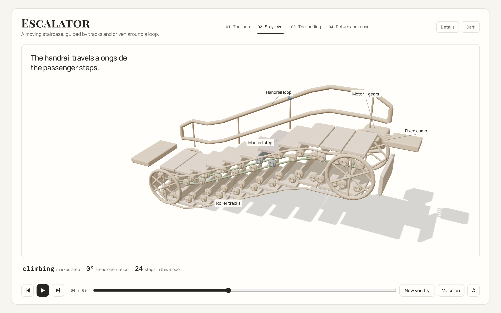
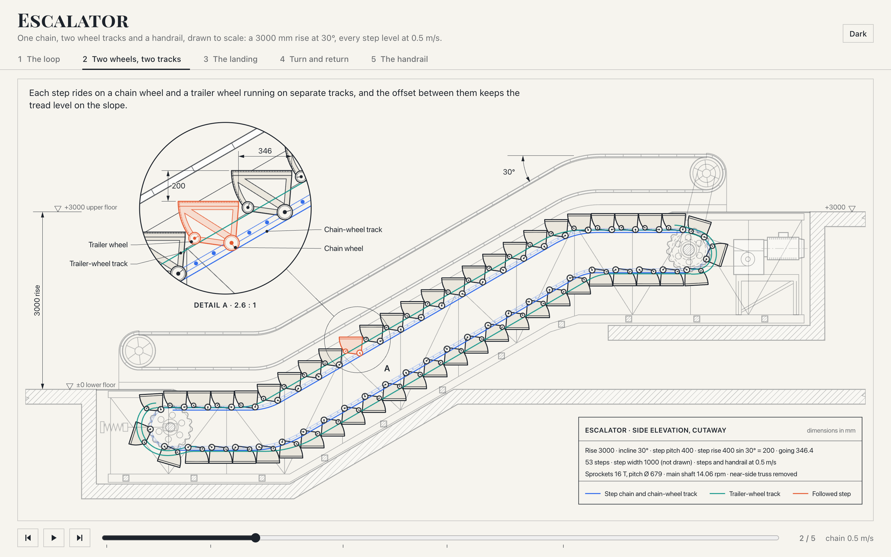
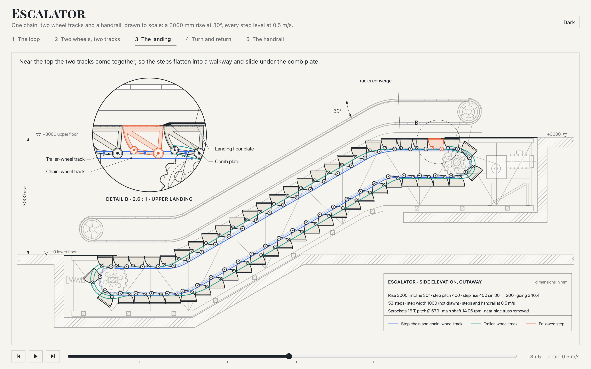
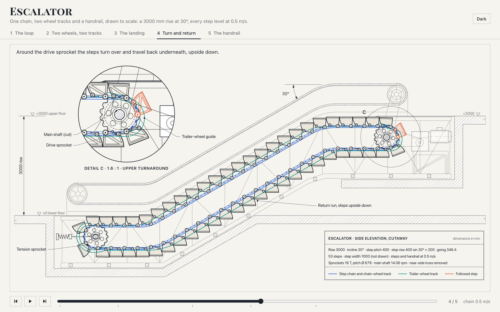
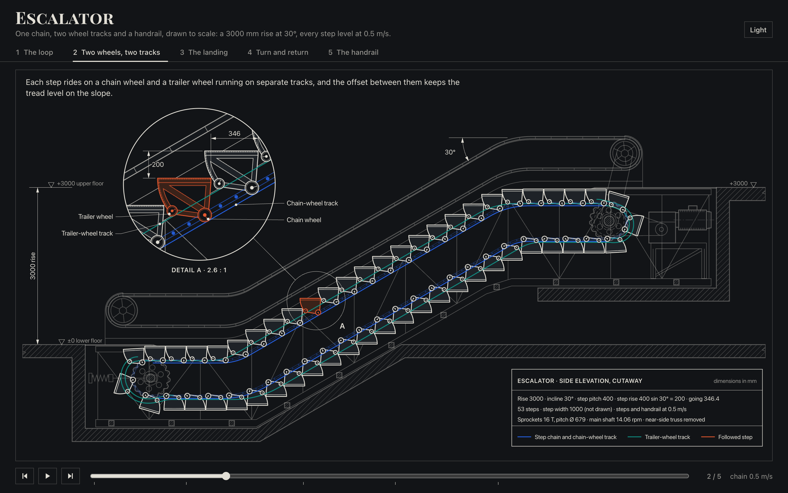

# Escalator: which look explains a mechanism best?

An experiment on this branch only. The same subject, how an escalator keeps every step level, is drawn three ways and compared at the same moment of the story.

| | Look | Source |
|---|---|---|
| **A** | Clay, the current 3D look | `test/escalator` (another run, screenshots only) |
| **B** | Technical side cutaway, sharp and to scale | [`cutaway/`](cutaway), new |
| **C** | Anatomy isometric | the Anatomy skill's own escalator example |

## The same moment: "the steps stay level"

<table>
  <tr>
    <td width="50%"><b>A. Clay</b><br></td>
    <td width="50%"><b>B. Technical cutaway</b><br></td>
  </tr>
  <tr>
    <td colspan="2" align="center"><b>C. Anatomy isometric</b><br></td>
  </tr>
</table>

## Verdict: B is better for mechanisms

- **The key fact can be seen.** The level treads come from two tracks offset on the slope and meeting at the landings. In B they are two coloured lines you can follow from one end to the other. In A they are thin green strokes buried behind about forty identical wheels, and in C they cannot be told apart from the rest of the solid.
- **The numbers are real.** It has a 3000 mm rise, a 30° incline, a 400 mm pitch, a 200 mm step rise and 53 steps that close the loop exactly. Twelve tests check them, along with level treads, no step collisions and wheels tangent to their rails. A labels "0° tread orientation" with 24 steps and no scale.
- **Detail goes where it matters.** A magnified circle shows the step at the moment the story is about: the step on the slope, the comb at the landing, then the turnaround. The overview stays clean.
- **It reads as engineering, not as a toy.** The building is cut and hatched, with a title block, dimension lines and leaders. A's rounded beige parts and the large shadow that means nothing are what made it look unprofessional.
- **C is precise but silent.** It is all grey-white with no labels, colour or story, so the reader has to know the mechanism already.

<table>
  <tr>
    <td width="33%"></td>
    <td width="33%"></td>
    <td width="33%"></td>
  </tr>
  <tr>
    <td><sub>3 · The landing: the tracks converge and the steps slide under the comb.</sub></td>
    <td><sub>4 · Turn and return: around the sprocket and back upside down.</sub></td>
    <td><sub>Dark theme.</sub></td>
  </tr>
</table>

## What B does not have yet

- **It is a one-off page, not built from the kit.** The figure is drawn by hand in `cutaway/build.mjs` (about 1,000 lines). It has no voice, no prediction, no What if, no Now you try, and `scripts/verify.mjs` doesn't check it.
- **Its own weak spots:**
  - in a side view, the rails cross the steps' side webs;
  - how the steps turn around each sprocket is a chosen schedule, not taken from a manufacturer's track;
  - the handrail return is simplified;
  - text drops to about 11 px at 1280×800.

## If we adopt it

Route by subject:

- **Abstract ideas** (binary search, LRU, heaps) stay in **Clay**.
- **Real mechanisms** get a new **Drawing** look: a sharp 2D side cutaway.

The Drawing look would need these kit parts:

- section hatching;
- dimension lines and level marks;
- leaders that avoid each other;
- detail circles with a scale;
- a title block.

It would run in the same player, so voice, predict and checks come for free. The cutaway's model and tests would be the first example.

## Open it

```sh
open explore/escalator/cutaway/escalator-cutaway.html     # the page: tabs, play, Space, Dark
node --test explore/escalator/cutaway/model.test.mjs      # 12 tests
node explore/escalator/cutaway/build.mjs                  # rebuild the page
```
