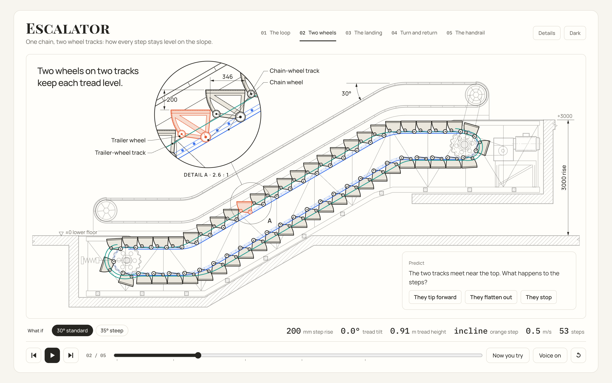
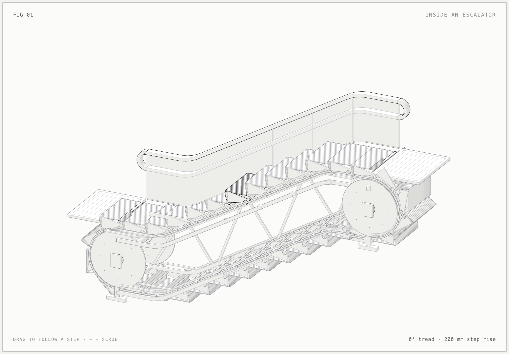
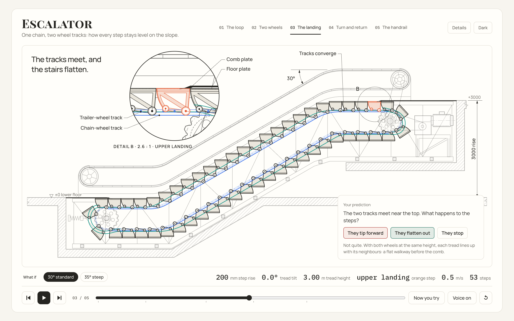
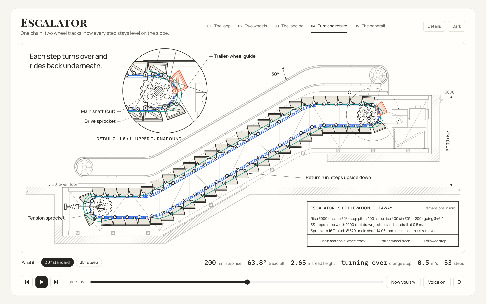
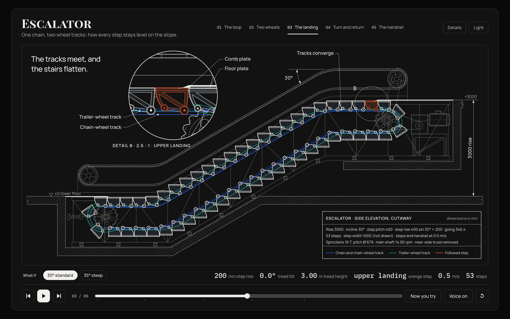

# Escalator: which look explains a mechanism best?

An experiment on this branch only. The same subject, how an escalator keeps every step level, is drawn three ways and compared at the same moment of the story.

| | Look | Source |
|---|---|---|
| **A** | Clay, the current 3D look | `test/escalator` (another run, screenshots only) |
| **B** | Technical side cutaway, sharp and to scale | [`cutaway/`](cutaway), new |
| **C** | Anatomy isometric | the Anatomy skill's own escalator example |

## The same moment: "the steps stay level"

<table>
  <tr>
    <td width="50%"><b>A. Clay</b><br></td>
    <td width="50%"><b>B. Technical cutaway</b><br></td>
  </tr>
  <tr>
    <td colspan="2" align="center"><b>C. Anatomy isometric</b><br></td>
  </tr>
</table>

## Verdict: B is better for mechanisms

- **The key fact can be seen.** The level treads come from two tracks offset on the slope and meeting at the landings. In B they are two coloured lines you can follow from one end to the other. In A they are thin green strokes buried behind about forty identical wheels, and in C they cannot be told apart from the rest of the solid.
- **The numbers are real.** It has a 3000 mm rise, a 30° incline, a 400 mm pitch, a 200 mm step rise and 53 steps that close the loop exactly. Twelve tests check them, along with level treads, no step collisions and wheels tangent to their rails. A labels "0° tread orientation" with 24 steps and no scale.
- **Detail goes where it matters.** A magnified circle shows the step at the moment the story is about: the step on the slope, the comb at the landing, then the turnaround. The overview stays clean.
- **It reads as engineering, not as a toy.** The building is cut and hatched, with a title block, dimension lines and leaders. A's rounded beige parts and the large shadow that means nothing are what made it look unprofessional.
- **C is precise but silent.** It is all grey-white with no labels, colour or story, so the reader has to know the mechanism already.

<table>
  <tr>
    <td width="33%"></td>
    <td width="33%"></td>
    <td width="33%"></td>
  </tr>
  <tr>
    <td><sub>3 · The landing, after the reader's prediction: the tracks meet and the stairs flatten.</sub></td>
    <td><sub>4 · Turn and return: around the sprocket and back upside down.</sub></td>
    <td><sub>Dark theme, step 3.</sub></td>
  </tr>
</table>

## B as a full Visualize page

B is wrapped in Visualize's own page: the card, the numbered tabs, a large step heading, a readout row computed from the model, and the play bar. It has the reader features:

- **Voice.** About 98 s of narration, recorded locally. It introduces the concept, then narrates each step, and each part lights as it is named.
- **Predict.** Before the landing, play stops on "The two tracks meet near the top. What happens to the steps?"
- **What if.** A switch between a 30° standard and a 35° steep escalator. The drawing, the numbers and the voice are all recomputed. For example, the step rise goes from 200 to 229 mm and the step count from 53 to 50.
- **Now you try.** Questions generated from the model, marked by the page, with a worked answer.
- **24 tests**, 12 for each incline.

What is still missing before it can be a skill feature:

- **It is not built from the kit yet.** The drawing is hand-written in `cutaway/build.mjs`, and `scripts/verify.mjs` doesn't check it. Making it a "Drawing" look in `src/` is the next step if we adopt it.
- **Weak spots:**
  - the predict and practice cards cover part of the drawing while open;
  - labels drop to about 11 px at 1280×800;
  - the orange step can jump between narrated steps;
  - in this side view, the rails cross the steps' side webs.

## Open it

```sh
open explore/escalator/cutaway/escalator-cutaway.html     # the page: tabs, play, Space, Dark
node --test explore/escalator/cutaway/model.test.mjs      # 24 tests
node explore/escalator/cutaway/voice.mjs                  # re-record the voice
node explore/escalator/cutaway/build.mjs                  # rebuild the page
```
