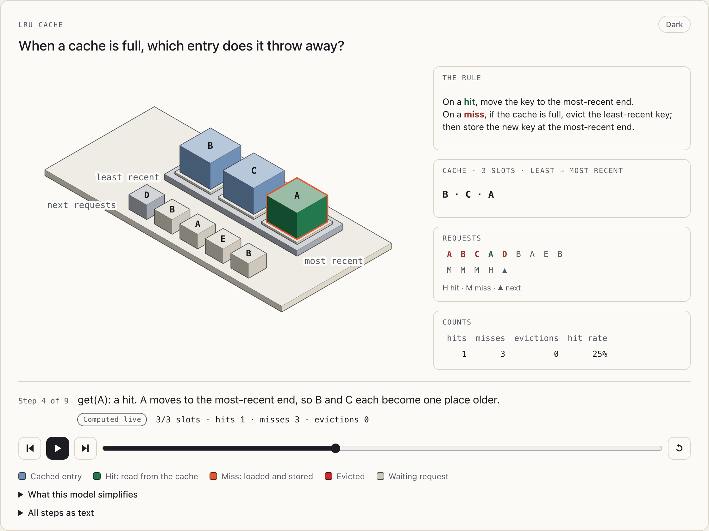
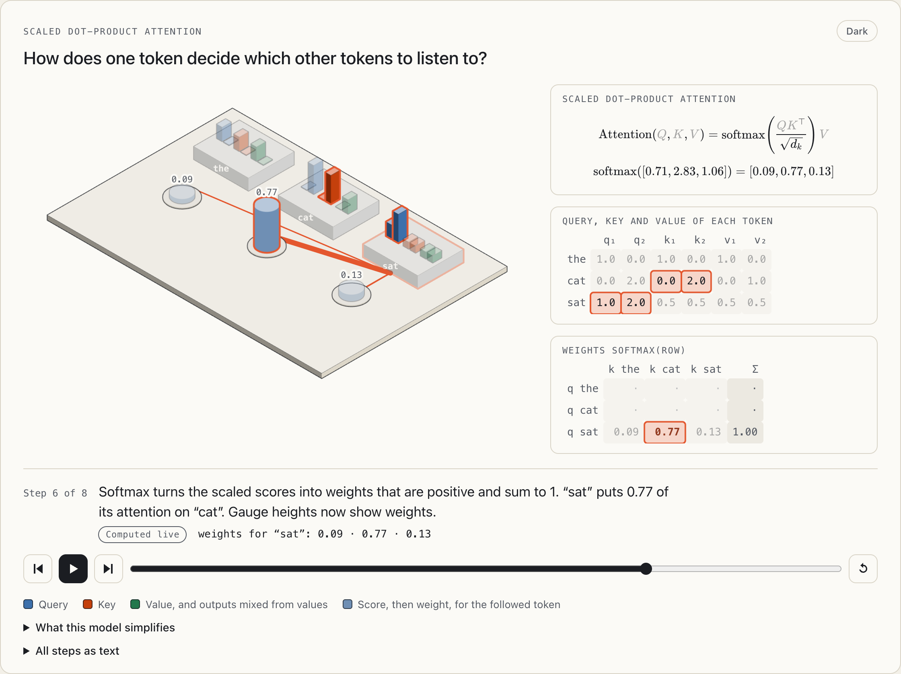
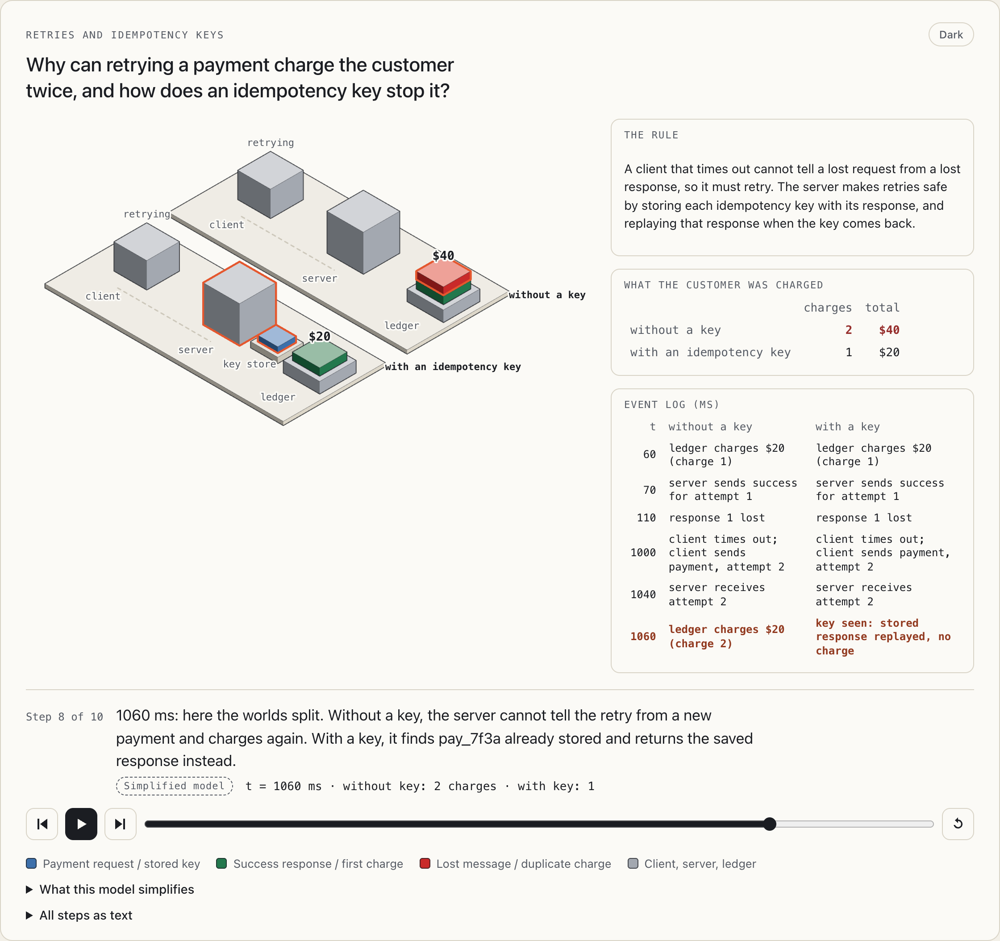

# Prototype findings

What three prototypes on one shared core showed, measured against the hypotheses in [Plan.md](../Plan.md), section D. Everything here comes from code in this repository and from screenshots taken by `pnpm verify`. Where a statement is judgment rather than measurement, it says so.

## Summary

- **The shared-substrate hypothesis held for these three scenes, with a caveat.** LRU eviction, scaled dot-product attention and payment retries all run on one core: a trace of steps, keyed marks per state, a pure `frameAt(t)`, an isometric SVG stage and flat panels. None needed a private renderer or hand-written tweens. But the views were not pure state-to-picture functions: each one supplies motion hints (`arc`, `leaving`, enter and exit styles, per-event timing). Motion derived purely from state differences was not enough.
- **The distinctive claim works.** `verify` checks the rendered page against an independent run of the model at every step: values, sizes, visibility, depth order, determinism, text and layout. 21 planted faults, at least one per check, are each caught while a clean fixture passes. The one untested branch is the labels check's outside-the-card test.
- **Checks did not replace looking.** The most serious defect found, a false claim in a caption, was caught by reading a contact sheet, not by any check. So were three rendering problems that later got checks of their own.
- **The craft gap to Anatomy is large.** Our figures are clear, correct and distinct from Anatomy's look, but they have a few chunky parts where Anatomy has dozens of fine ones. That is a judgment from side-by-side screenshots, not a measured result.

## What was built

More in [images/](images/): the LRU motion sheet, the flat LRU variant step by step, and retries at 390 px.

| Part | Lines (excluding tests) | Role |
|---|---:|---|
| `src/core` | 648 | Types, trace and steps, timeline, keyed interpolation, motion vocabulary, trust levels |
| `src/iso` | 302 | Projection, box and cylinder faces, depth sort |
| `src/render` | 1,324 (incl. 381 CSS) | SVG reconciler, player, panels, math, themes, label fit and separation |
| `scripts` | 1,208 | Build, verify, in-page checks, screenshots |
| `examples/lru` | 121 model + 209 scene | Recency rail; isometric and flat variants |
| `examples/attention` | 97 model + 370 scene | Gauges that morph score → scaled → weight; linked equation and grids |
| `examples/retries` | 145 model + 299 scene | Discrete-event simulation run as two synced worlds |

Each example is 300–470 lines of model and scene for an 8–10 step explanation with linked panels. Built pages are 45–49 KB, except attention at 688 KB, which inlines KaTeX and all of its fonts. Subsetting the fonts is an open task. There are 49 unit tests.

## Verdicts on the falsifiers

| Approach | Falsified if | Result |
|---|---|---|
| Temporal world + semantic motion | Motion derived from state diffs looks mechanical, or views need hand-written tweens | **Partly falsified.** No hand-written tweens were needed. Plain diff-interpolation was not enough, though: a hit in LRU passes through its neighbours unless it hops (`arc`), and an eviction reads as "vanish" unless the view says where the entry goes (`leaving`). Views carry motion hints, so the motion vocabulary is semantic, not automatic. |
| Living mathematics + lens stack | Term-level identity in rendered math is too fragile, or the trace model cannot express it | **Not falsified.** KaTeX's `\htmlData` (with only that command trusted) gives each term an entity id, and linking works across the equation, grids and stage. A planted fault proves the check. However, the "graph of computed values" source of truth was not built: identity comes from an id naming convention (`q-2`, `k-1`), not from a value graph. That is weaker than the hypothesis. |
| Causal simulation + twin worlds | Two synced worlds do not fit a phone-width layout legibly | **Partly confirmed.** At 390 px every check passes (labels readable at 11 px or more, nothing overlapping or clipped), but by eye the scene is cramped and small. Wide scenes need a responsive camera, which the engine does not have. |

## Where the core had to grow

Each item was found by building an example, then fixed in the engine rather than in the example.

| Need | Found in | Change |
|---|---|---|
| An entity's exit should show where it goes | LRU eviction | `leaving` marks |
| A reorder must not pass through neighbours | LRU hit | `arc` hop, later also for transients (attention) |
| Hop and effects only ran in the second half of a move | Unit tests for `arc` and `pulse` | Read them from the destination mark |
| A pulsing part sank into what it rests on | `verify` depth check (retries) | Pulses grow from the base |
| Labels on stacked tops were hidden | `verify` labels check (stack fixture) | `labelFace` for side-face labels |
| Label ink was cached from a detached element | `verify` contrast check | Ink picked after attachment, by measured contrast |
| Labels spilled out of the stage on phones | `verify` layout check | Labels clamped to 11–14 px; the camera fit measures labels and iterates |
| Labels collided on phones | `verify` labels check (retries) | Deterministic vertical label separation |
| One cell must light two vectors | Attention | Several ids per element, related by containment |
| Floor lines were hidden under the base plate | Screenshot review (attention) | A ground layer below floor lines |
| Panels widened the page on phones | `verify` layout check (LRU) | Panels contain their overflow |

## Defects only review by eye found

These passed every check at the time they were made.

1. **A false caption (LRU).** It said "a first-in-first-out cache would have dropped A" at steps where a FIFO cache, run on the same requests, would no longer hold the same keys. The claim is now computed from a real FIFO run and made only where both caches hold identical contents, with a test.
2. **Attention's weight lines were invisible**, under the base plate. This led to the ground layer, and later to `visible` meaning "can be seen".
3. **Retries' messages were hidden behind the server.** This led to the network path layout and to the seen-share visibility check.
4. **Linked highlighting lit too much.** Sharing any id lit whole rows and columns; it now uses containment.
5. **The paper's hedge was lost.** "We suspect…" became a statement of fact in a sourced caption, and has been restored.

Items 2 and 3 now have checks, with planted faults proving them. Item 1 has a unit test, but the class of defect behind it, a caption that is true of the model but false about the world it compares with, has no general check.

## What `verify` can and cannot claim

It **can** show that, at every step of the declared trace:

- the declared observations hold in the rendered page;
- captions, readouts and trust labels equal the model's;
- solids are painted in true depth order wherever they overlap on screen (ray-cast against the geometry, at rest and at four instants in every transition);
- the page is a pure function of time;
- text meets size and contrast minimums in both themes;
- labels don't collide, spill or hide;
- the layout holds at 1280 and 390 px;
- keyboard, reduced motion and step links work;
- linked highlighting lights exactly the related elements.

It **cannot** show:

- that the representation is a good choice, or that the explanation teaches;
- that the observations are complete: it checks what the author declared, and an undeclared number goes unchecked;
- that captions are true about anything outside the model (see defect 1);
- link stroke widths, colours meaning what the legend says, or text inside KaTeX equations;
- that motion between the sampled instants is smooth;
- anything about craft or beauty.

A planted fault per check proves the check can fail (except the outside-the-card test). It does not prove the check catches every fault of that kind.

## Process notes

- One commit, `e330280` ("add leaving and arc motions"), landed on `main` with a failing test, because the commit command was gated on `grep` output rather than the test exit code. `72fc9e0` fixed it, and every later commit was gated on the exit code.
- The retries commits were briefly made on `main` without a branch; they were moved onto `feat/example-retries` and merged before anything was pushed.
- An early claim that every check had a planted fault was not true: reduced motion, step links, layout, dark-theme contrast, order and lit observations, and parts of the labels check had none. Eight controls were added; one gap remains, as noted above.

## Recommended next steps

In priority order (judgment):

1. **A responsive camera:** fit, or re-arrange, wide scenes for narrow screens instead of shrinking them.
2. **A craft pass on the stage vocabulary:** bevels, seams, rounded plans, part detail. This is the largest gap to Anatomy's quality bar, and it should be measured by side-by-side review.
3. **The paper adapter:** source extraction with locations, so sourced steps link to the exact passage. Attention is the first scene for it.
4. **Font subsetting for KaTeX pages.**
5. **The Agent Skill:** a concise `SKILL.md` over this library, then the benchmark the brief asks for, with and without the skill on the same prompts.
